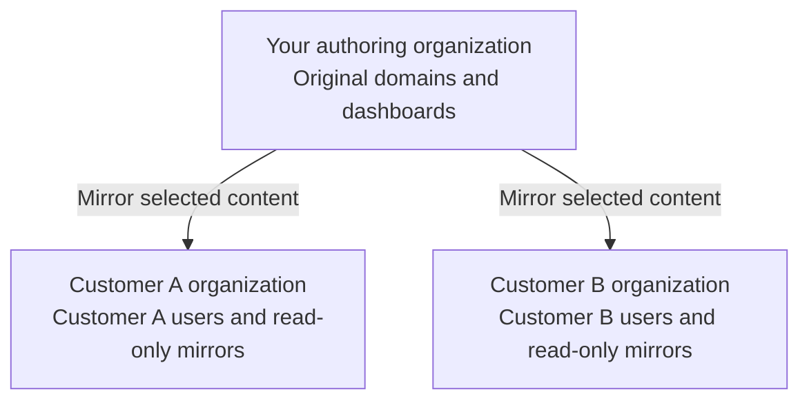

Object mirroring lets you share domains and dashboards across customer organizations. Your team maintains the originals, and each customer uses a live, read-only mirror in their own organization. Changes to the originals appear in the mirrors, so you do not need to update a copy for each customer.

Each customer gets their own WisdomAI organization, so one customer's users stay isolated from your other customers. This page explains how mirrors, organizations, and data access fit together. To configure mirroring, see [Set up object mirroring](/access-management/set-up-object-mirroring).

## Reuse analytics across customers

Suppose several customers need the same revenue definitions and sales dashboard. Mirroring lets you reuse that content while you manage each customer's users and data access separately.

You can:

- Give a new customer existing domains and dashboards without rebuilding them.
- Manage metric definitions, business context, and dashboard changes in one organization.
- Let customers ask questions using a shared domain without letting them edit it.
- Choose which organizations receive each object and who can access it.

A domain provides the data sources, definitions, and instructions for answering questions. A dashboard presents prepared results. Mirror a domain for exploration, a dashboard for reporting, or both.

## What a mirror is

A mirror is a read-only, live view of a source domain or dashboard. WisdomAI does not copy the source content. The mirror refers to the original, so it stays synchronized with it.

- Customers cannot edit a mirror. You edit the original in the authoring organization.
- Mirroring does not change warehouse refresh schedules. It also does not guarantee that an open browser redraws immediately.
- You cannot mirror an existing mirror into another organization. Create each mirror from the original object.
- A mirror depends on its original. Keep the original and its organization active while customers need the mirror.
- Mirroring a dashboard does not mirror its domain. Mirror each object separately.

In the WisdomAI interface this feature is called Mirror. The GraphQL API still uses the names publish and publication. See [Set up tenant organizations and mirrors with the API](/integrations/user-management/mirror-with-the-api).

## Where content and users belong

Use one organization for authoring the shared content and a separate private organization for each customer.

| Where | What belongs here | Who manages it |
|---|---|---|
| Authoring organization | Original domains, business definitions, and standard dashboards | Your central analytics team |
| Customer organization | That customer's membership, access to mirrors, and locally created content | Administrators with access to that organization |
| User groups within a customer organization | Optional groupings such as analysts or managers | The customer organization's administrators |

Add customer users to their customer organization. They do not need membership in the authoring organization to use its mirrors. Administrators who manage mirroring need permissions in both the source and destination organizations.

A Site Administrator creates the customer organizations. See [Manage Organizations](/access-management/manage-organizations).

## What customer users can do

Users in a customer organization can use mirrored content as follows:

- View mirrored dashboards and load their widget data.
- Browse mirrored domains.
- Chat using mirrored domains.

They cannot change the shared definitions or dashboards, and they cannot access another customer's organization.

## Access to content and access to data

Mirroring controls access to shared content. Your data policies control which records a viewer can see.

Mirrored objects follow the viewer's permissions, not the permissions of the person who shared them. Row-level security (RLS), column-level security (CLS), and connection parameters apply according to the viewer's own identity. Configure the viewer's identity, row-level security, column-level security, and connection parameters as needed. An organization name or dashboard filter does not enforce access to customer records.

For more on data policies, see [Row-Level Access Control](/manage-account/row-level-access-control/row-level-access-control).

## What stays hidden from tenant users

Mirrored objects hide sensitive source context. Customers do not see the source's chats or authoring metadata, such as original messages and AI workstream details, including SQL and RLS debug information.

## Target access

When you mirror an object, you choose who in each destination organization can access it.

| Target access | What it does |
|---|---|
| Admins only | Administrators can access the new mirror. This setting does not grant access to all users. Use it to review a mirror before a wider rollout. |
| All users | Users in each selected organization can read the mirror, including users added later. This setting does not make the mirror public or give every account user access. |

A target-access change applies to every selected organization when you save. Switching a mirror to Admins only removes its all-user grant. It does not remove individual or group grants you added separately.

## Limits

- The mirror dialog loads up to 100 eligible organizations. For larger rollouts, provision mirrors through the API.
- Select all organizations selects the organizations currently available. It does not include organizations created later.
- If you do not see **Mirror**, ask your administrator to check your permissions and whether your account has mirroring enabled.

## Related articles

<CardGroup cols={3}>
  <Card title="Set up object mirroring" icon="list-check" href="/access-management/set-up-object-mirroring">
    Create customer organizations, add users, and mirror domains and dashboards.
  </Card>
  <Card title="Set up tenant organizations and mirrors with the API" icon="code" href="/integrations/user-management/mirror-with-the-api">
    Provision organizations, users, and mirrors with GraphQL.
  </Card>
  <Card title="Manage Organizations" icon="building" href="/access-management/manage-organizations">
    Create, edit, and archive organizations as a Site Administrator.
  </Card>
</CardGroup>
