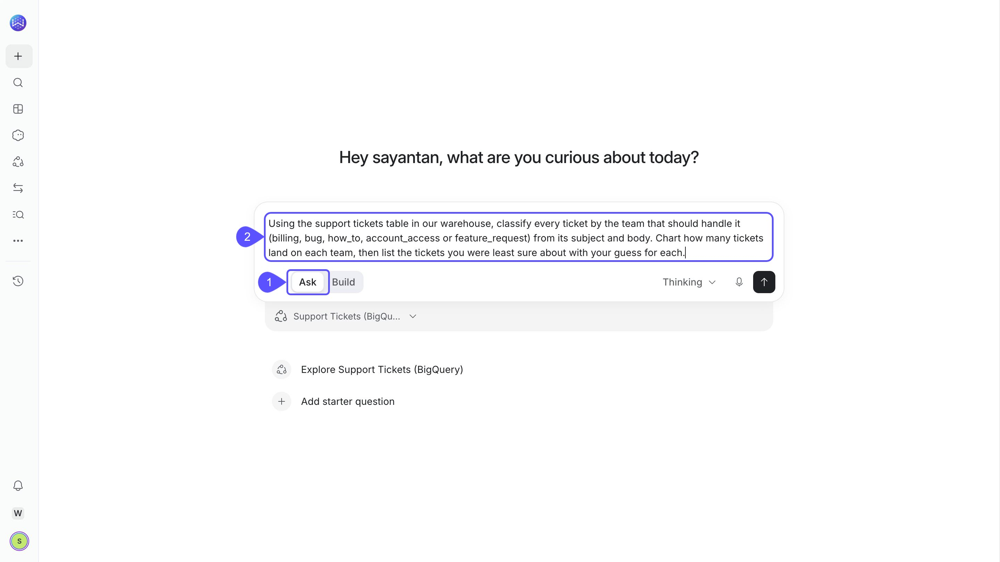
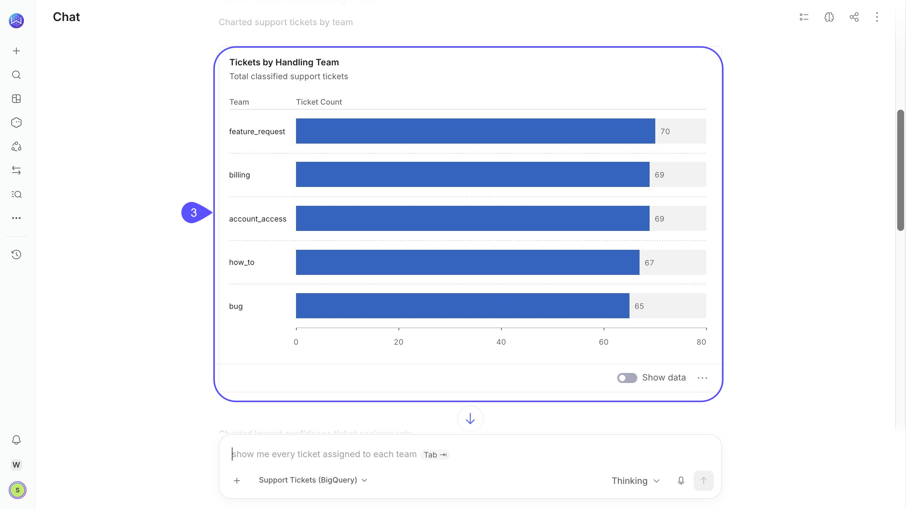
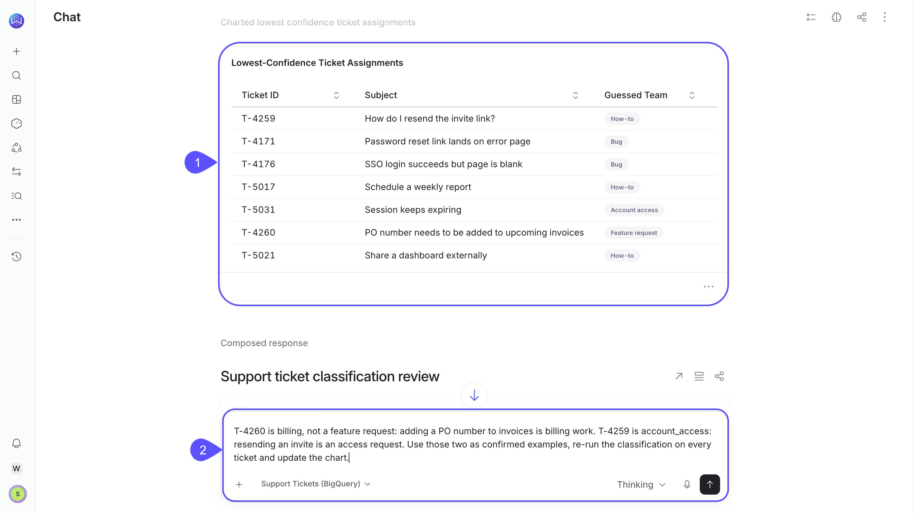
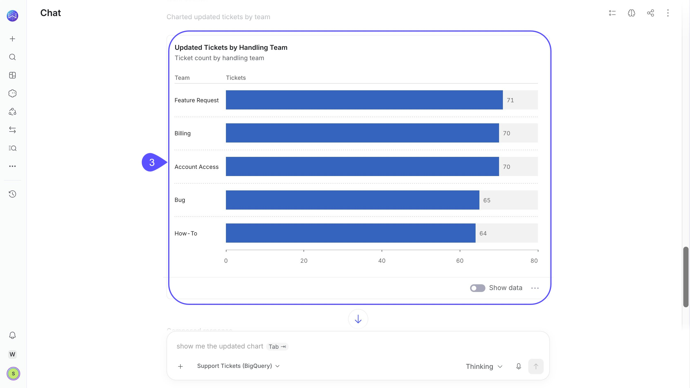
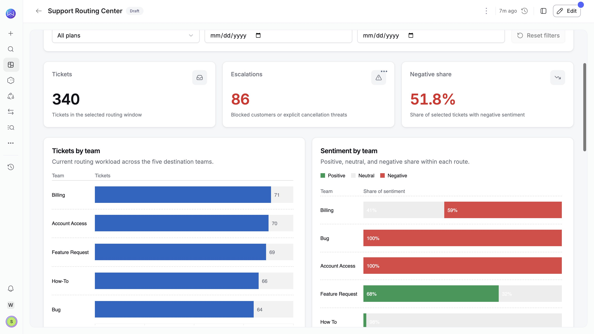

AI functions let you analyze unstructured text in your warehouse using natural language. They turn information from support tickets, customer feedback, and other text fields into categories, sentiment labels, and judgments you can filter, compare, and visualize alongside your business data.

You can use AI functions directly in Chat without writing Python or installing additional extensions in your warehouse.

The demo below shows how WisdomAI classifies 340 synthetic support tickets, refines the results using corrections, and builds a support routing app.

{/* Pending approval: Geetesh has not confirmed this launch-style video for the public page. */}

<video
  src="/videos/ai-functions-support-routing.mp4"
  controls
  playsInline
  preload="metadata"
  poster="/images/ai-functions-video-cover.jpg"
  aria-label="Demo showing support ticket classification, corrections, and Live App creation"
  className="w-full aspect-video rounded-xl"
/>

## What you can ask for

| Task | Example question | Result |
| --- | --- | --- |
| Classify | Group these tickets into billing, bug, how-to, account access, and feature request. | One category per ticket, with counts or charts by category. |
| Filter by meaning | Show tickets where the customer is blocked or threatening to cancel. | Matching tickets, even when they use different wording. |
| Analyze sentiment | Label these survey comments positive, neutral, or negative and compare them by plan. | A sentiment label per comment and a breakdown by plan. |
| Score against a rubric | Assign urgency 1, 2, or 3: 1 is routine help, 2 is impaired work, and 3 is a customer who cannot work. | One of the score labels you define. |

Use AI functions when your analysis depends on the meaning of text rather than exact matches or existing values. For categories already stored in your data, keyword matches, and numeric calculations, WisdomAI can query the data directly.

For scoring tasks, define what each level means. WisdomAI selects from your specified labels rather than generating an unrestricted numerical score.

## Classify support tickets

To classify support tickets, define the handling teams or categories and the text fields to analyze, such as the subject and description. WisdomAI assigns labels based on the ticket content and visualizes how requests are distributed.

1. **Select Ask mode and a domain.** Start a new chat, select **Ask**, and choose a domain containing your support ticket data.
2. **Enter a classification prompt.** Describe the text to analyze, the categories to use, and the results you want.

These prompts illustrate the workflow shown in the demo. Adapt them to your own data, categories, and analysis goals.

The demo uses the following prompt to classify support tickets and visualize the results:

```text
Using the support tickets table in our warehouse, classify every ticket by the team that should handle it (billing, bug, how_to, account_access or feature_request) from its subject and body. Chart how many tickets land on each team, then list the tickets you were least sure about with your guess for each.
```

<Frame>
  
</Frame>

WisdomAI evaluates each ticket's subject and body, classifies it by handling team, and charts the results.

3. **Review the classification results.** Check how the tickets are distributed across the five handling teams.

<Frame>
  
</Frame>

All 340 tickets in this example are classified.

For large datasets, narrow the analysis using a date range, region, or other relevant filter. Check which rows were included before interpreting the results as totals for your entire warehouse.

If you don't know which categories to use, ask WisdomAI to suggest common themes and review the proposed categories before applying them.

## Review uncertain examples and correct them

Some tickets may fit more than one category. WisdomAI can show the examples it was least sure about, along with its suggested classifications, so you can review and refine the results.

1. **Review the suggested classifications.** Identify tickets that may belong to a different category.
2. **Correct the classifications.** Provide the correct labels in Chat and ask WisdomAI to rerun the analysis.

The following example corrects two ticket classifications and reruns the analysis using the confirmed labels:

```text
T-4260 is billing, not a feature request: adding a PO number to invoices is billing work. T-4259 is account_access: resending an invite is an access request. Use those two as confirmed examples, re-run the classification on every ticket and update the chart.
```

<Frame>
  
</Frame>

3. **Review the updated results.** Check the revised chart to see how the classifications changed.

<Frame>
  
</Frame>

WisdomAI reruns the classification using the confirmed examples. In this demonstration, the corrected tickets move to their intended teams, and other tickets are also reassessed.

Corrections guide the new analysis. They don't retrain the model or establish permanent rules for future conversations.

To review individual classifications, ask WisdomAI to show the underlying tickets for any category.

## Reuse the analysis in a dashboard or Live App

Once you've reviewed the classifications, you can add the results to a dashboard or build a Live App that combines them with other analyses.

The demo uses the following prompt in **Build** mode to create the Support Routing Center:

```text
Build a support routing app on the support tickets table in our warehouse. Label every ticket with the team that should handle it (billing, bug, how_to, account_access or feature_request), its sentiment, and whether the customer is blocked or threatening to cancel. Show headline numbers (tickets, escalations, negative share), tickets by team, sentiment by team, team mix by plan, daily tickets by team and an escalation queue, with plan and date filters. Keep it live: every refresh should re-label the tickets from the warehouse.
```

The resulting Live App brings together ticket classifications, sentiment analysis, escalation indicators, and filters for exploring the data.

<Frame>
  
</Frame>

When the analysis runs again, WisdomAI can reuse stored judgments for unchanged inputs when the classification criteria and configuration match. Values without stored answers are evaluated, and changes to the criteria or confirmed examples can trigger reevaluation.

Judgment reuse is best-effort, so review the results after a refresh.

For information about refresh schedules and data scope, see [How data stays fresh](/live-apps/data-and-trust#how-data-stays-fresh).

To learn more about reusing analyses, see [Turn Answers into Dashboards](/using-wisdom-ai-everyday/turn-answers-into-dashboards) and [Create a Live App](/live-apps/create-live-app).

## Limits

{/* Confirm availability and prerequisite wording with Engineering before publication. */}

- AI functions require the appropriate account and domain configuration, including a supported decision model. Contact your administrator or WisdomAI support if the feature is unavailable.
- A classification call supports up to 10,000 distinct input values or combinations of selected columns. Repeated values are evaluated once and mapped back to their rows.
- Very long inputs may be truncated, and some values may remain unanswered if evaluation fails. Check reported failures before treating results as complete.
- AI-generated classifications are judgments. Review ambiguous cases before using them for consequential decisions.

## Next steps

<CardGroup cols={2}>
  <Card
    title="Ask Better Questions"
    icon="question"
    href="/using-wisdom-ai-everyday/ask-better-questions"
  >
    Learn how to write effective questions for your data.
  </Card>

  <Card
    title="Create a Live App"
    icon="pencil"
    href="/live-apps/create-live-app"
  >
    Build an interactive app from your data and analysis.
  </Card>
</CardGroup>
