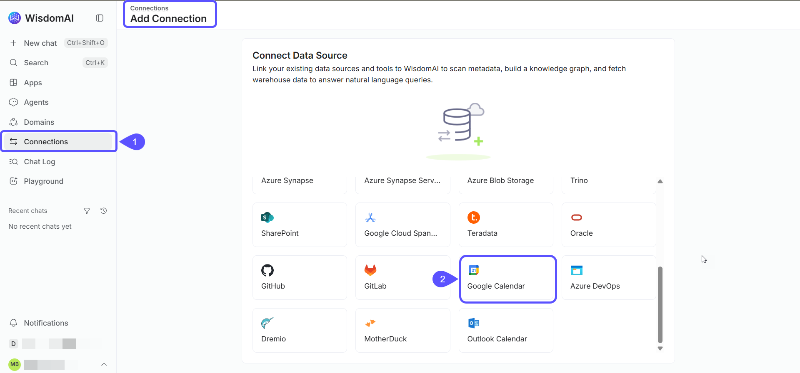
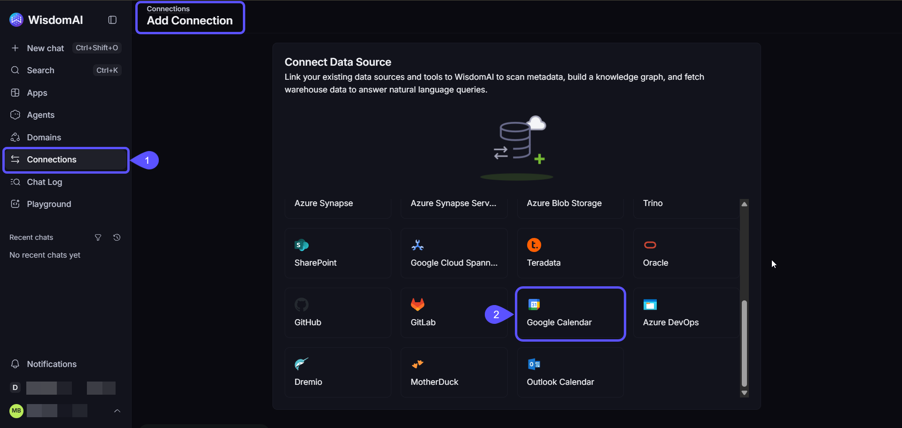
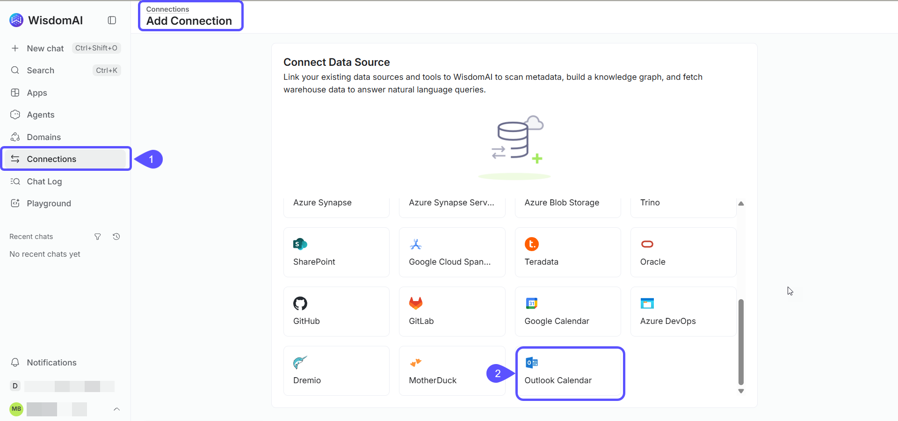
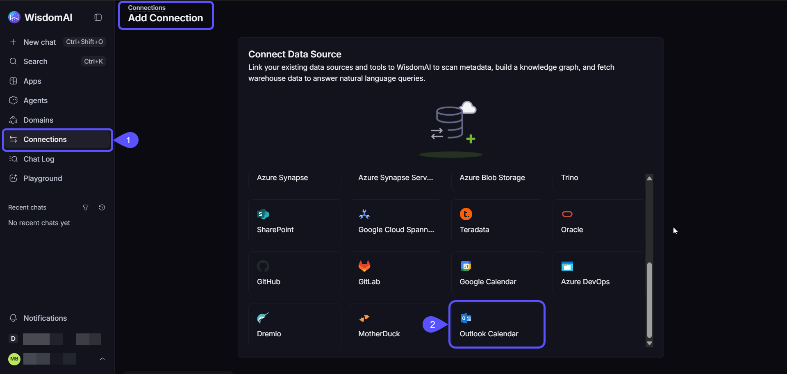

Calendar connections let agents start a run from calendar events with the agent **Calendar** trigger. WisdomAI supports Google Calendar and Outlook Calendar.

An admin adds the connection with an OAuth app. Then each person connects their own calendar.

<Note>
  Calendar connections don't crawl data and can't be added to a domain.
</Note>

## Prerequisites

- [Admin access](/manage-account/access-management) to your WisdomAI Organization.
- An OAuth app for the calendar provider. The requirements are listed in each section below.

## Add the connection

Both providers follow the same flow: enter the details, click **Connect** to authorize your account, then click **Save**.

<Note>
  Connect your account before you save. Other members authorize their own accounts later under **Settings** → **Connected Apps**.
</Note>

### Google Calendar

1. Go to **Connections** and click **Add connection**.
2. Select **Google Calendar** from the list of sources.

<Frame>
  
  
</Frame>

3. Enter a **Connection name** and the details of your OAuth app. The Calendar API must be turned on.

| Requirement | Description |
| :-- | :-- |
| OAuth client ID | The client ID of your OAuth app |
| OAuth client secret | The client secret of your OAuth app |

4. Register the redirect URI shown on the form in your OAuth app.
5. Click **Connect** and authorize your Google account.
6. Click **Save**.

<Frame>
  
  
</Frame>

### Outlook Calendar

1. Go to **Connections** and click **Add connection**.
2. Select **Outlook Calendar** from the list of sources.

<Frame>
  
  
</Frame>

3. Enter a **Connection name** and the details of your Microsoft OAuth app.

| Requirement | Description |
| :-- | :-- |
| Client ID | The client ID of your OAuth app |
| Client secret | The client secret of your OAuth app |
| Tenant | **Common (multi-tenant and personal accounts)**, or **Specific Microsoft Entra tenant** |
| Tenant ID | Required with **Specific Microsoft Entra tenant** |

4. Register the redirect URI shown on the form in your OAuth app.
5. Click **Connect** and authorize your Microsoft account.
6. Click **Save**.

<Frame>
  
  
</Frame>

## Connect your calendar

Other members connect their own calendar:

1. In the left-hand navigation, click the **Settings** icon.
2. Select **Connected Apps**.
3. Connect your calendar.

Calendars appear on the **Connected Apps** page next to MCP apps. For how that page works, see [Connected Apps](/settings/connected-apps).

## Use a calendar in an agent

Add the **Calendar** trigger to an agent to start a run from calendar events. See the trigger nodes in the [Nodes Reference](/setting-up-wisdom-ai/agents/nodes-reference#trigger-nodes).

## Next steps

<CardGroup cols={2}>
  <Card title="Connected Apps" icon="plug" href="/settings/connected-apps">
    Sign in to the OAuth-secured apps your administrator has set up.
  </Card>

  <Card title="Nodes Reference" icon="diagram-project" href="/setting-up-wisdom-ai/agents/nodes-reference">
    See every agent node type, including the Calendar trigger.
  </Card>
</CardGroup>
