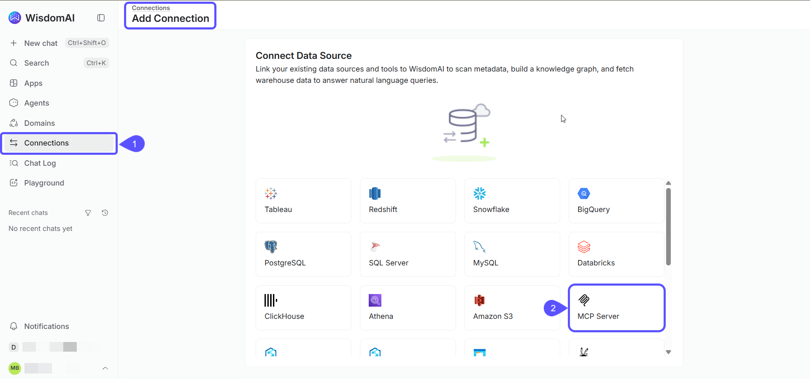
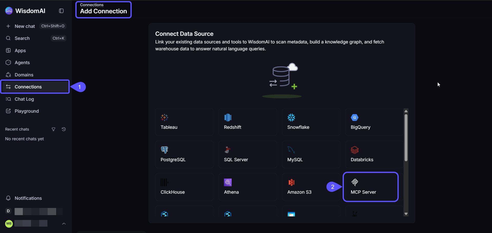
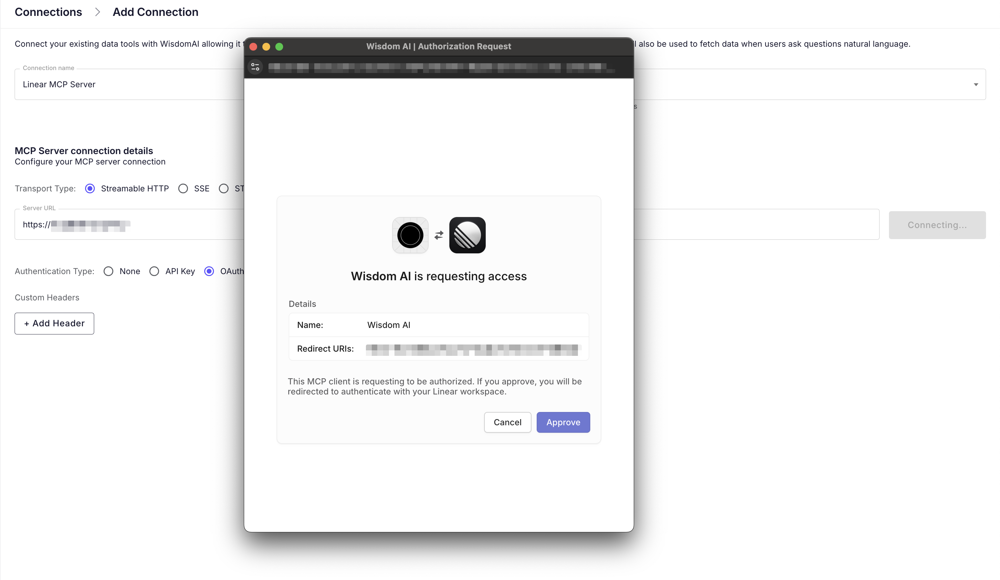
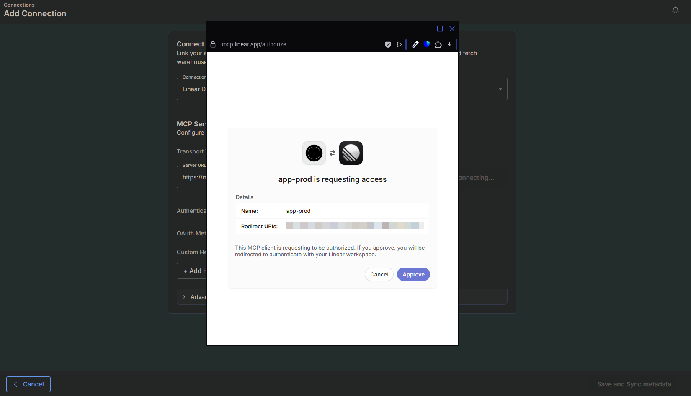
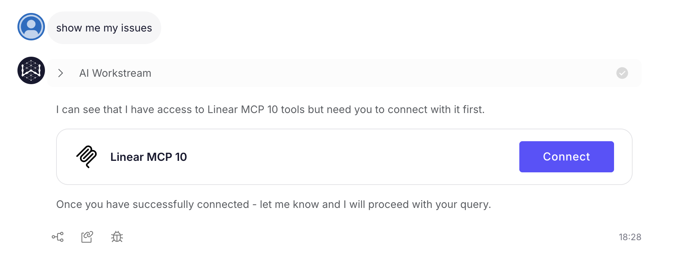
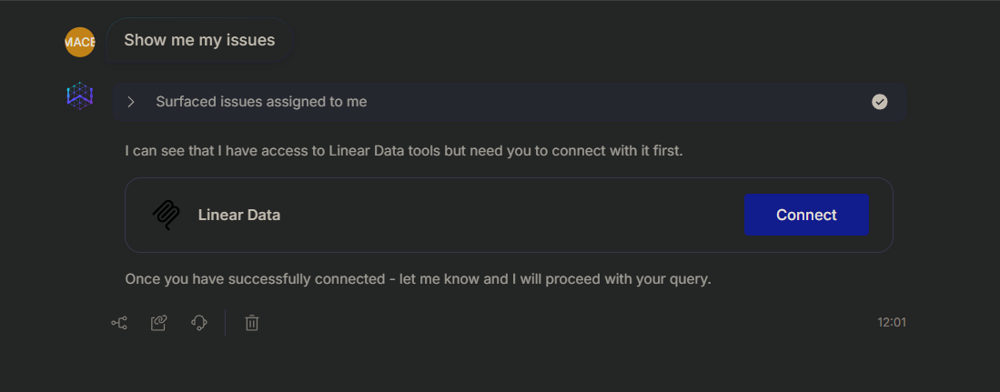

WisdomAI allows you to connect to any server that implements the [Model Context Protocol (MCP)](https://modelcontextprotocol.io/docs/getting-started/intro). This integration enables WisdomAI to scan metadata, build a knowledge graph, and fetch real-time data to generate visualizations when users ask natural-language questions.

<Note>
  To connect an AI client to WisdomAI's hosted MCP server, see [WisdomAI MCP Server](/integrations/mcp-server).
</Note>

## Prerequisites

- [Admin access](/manage-account/access-management) to your WisdomAI Organization.
- The Server URL (for HTTP/SSE) or Command (for STDIO) of your MCP server.
- Authentication credentials (API Key, OAuth configuration, or Azure service principal details), if required by your server.

## Connect an external MCP server

Follow these steps to register your MCP server as a data source in WisdomAI.

1. Navigate to **Connections** \> **Add connection**.
2. Select **MCP Server** from the list of sources.

<Frame>
  
  
</Frame>

3. Enter a unique **Connection name** (e.g., "Linear MCP Server").
4. Select the **Transport Type** supported by your server:
   - **Streamable HTTP**: Uses standard HTTP streaming for communication.
   - **SSE**: Uses Server-Sent Events.
   - **STDIO**: Runs the server as a local process via standard input/output.
5. For HTTP and SSE servers, enter the **Server URL**. For STDIO servers, enter the **Command**, **Arguments**, and **Environment Variables**. Arguments can reference connection variables as `${VAR}`.
6. Select the **Authentication Type** (STDIO servers don't have this setting):
   - **None**: For public or internal servers without auth.
   - **API Key**: Uses a static key for all requests. Add the key as a custom header in the next step.
   - **OAuth**: Uses user-based authentication. Select **Dynamic Client Registration** or **Static Credentials** (enter a **Client ID** and **Client Secret**).
   - **Azure Service Principal**: Authenticates with an Azure service principal. Enter its **Client ID**, **Tenant ID**, **Client Secret**, and **Scope**.
7. (Optional) Click **\+ Add Header** to add any custom headers required by your server. If you're using API Key authentication, add the key as a custom header.
   <Frame>
     
     
   </Frame>
8. If you selected OAuth, click **Connect** and complete the authorization. Then click **Save and Sync metadata** to save the connection.

<Info>
  **User-based authentication**

  If you select **OAuth**, authentication happens on a user-by-user basis. WisdomAI does not store a global credential. Instead, when a user asks a question that requires data from this server, WisdomAI will prompt them to authenticate via a secure pop-up during the chat session.
</Info>

## Additional settings

- **Request timeout**: Under **Advanced settings**, you can set the request timeout from 10 to 600 seconds. The default is 120 seconds.
- **Connection name**: MCP connection names can be up to 30 characters.
- **OAuth token refresh**: OAuth connections to Microsoft Entra and Google servers refresh their tokens, so people are asked to reconnect less often. If a server's OAuth settings change, use **Refresh OAuth settings and reconnect**.

For checks that run when you save, see [What happens when you save](/getting-started/connect-data-sources/supported-data-sources#what-happens-when-you-save).

## Validate the connection

Once connected, you can verify the integration by asking a natural language question in the chat interface.

1. Start a **Chat**.
2. Ask a question relevant to the connected tool (e.g., "Show me my issues").
3. If using OAuth, and you haven't authenticated yet, WisdomAI will detect the need for authentication. Click **Connect** in the chat response and Authorize the request in the pop-up window. \
   WisdomAI will pull the requested data and generate the appropriate visualization or text response.

## Next steps

<CardGroup cols={3}>
  <Card title="Connect to Databricks" icon="layer-group" href="/getting-started/connect-data-sources/connect-to-databricks">
    Connect to Databricks using a Client ID and Client Secret for authentication, enabling secure and controlled access to your data.
  </Card>

  <Card title="Connect to Google BigQuery" icon="google" href="/getting-started/connect-data-sources/connect-to-google-bigquery">
    Connect to Google BigQuery using a Google Cloud Platform Service Account for secure and granular access to your data.
  </Card>

  <Card title="Connect to Amazon Redshift" icon="aws" href="/getting-started/connect-data-sources/connect-to-amazon-redshift">
    Connect to Amazon Redshift using three methods: Direct Connection, SSH Tunnel, or VPC Peering, according to your network architecture.
  </Card>
</CardGroup>
