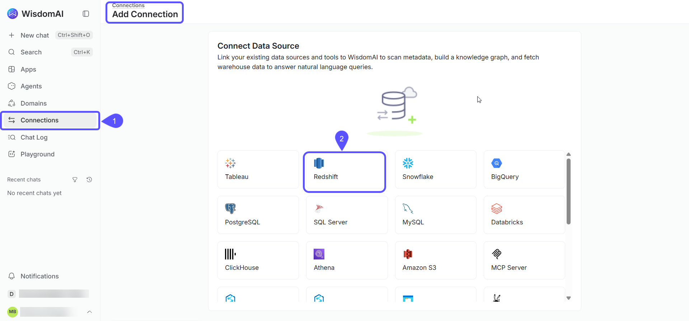
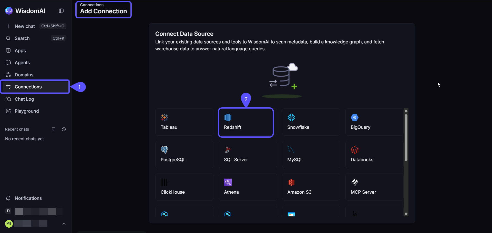
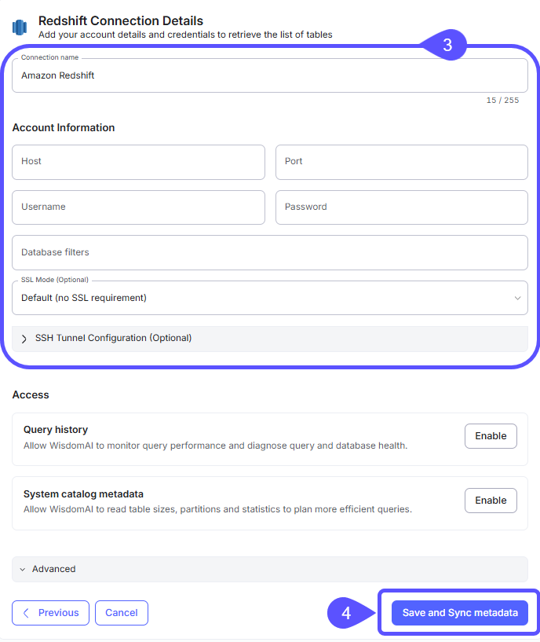
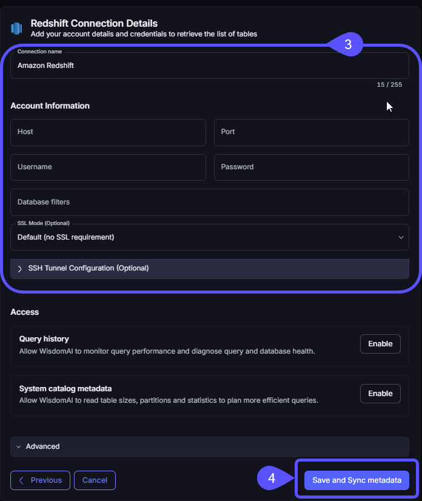

WisdomAI allows you to connect to Amazon Redshift by choosing one of three methods:

1. [Direct Connection](#option-1-direct-connection)
2. [Connect via an SSH Tunnel](#option-2-connect-via-an-ssh-tunnel)
3. [Connect via VPC Peering](#option-3-connect-via-vpc-peering)

This flexibility ensures you can establish a secure connection that matches your specific network architecture.

## Prerequisites

Before you begin, make sure you have the following:

- Your Amazon Redshift cluster endpoint, port, database name, and user credentials.
- Network access that allows WisdomAI to connect to your Redshift cluster. This may require configuring your firewall or AWS security groups.
- If using an SSH tunnel, you need the credentials for your bastion host.
- If using VPC peering, you need permissions to manage VPC settings in your AWS account.

## Option 1: Direct connection

Use this method if your Redshift cluster is publicly accessible or if you have allowlisted WisdomAI's CIDR blocks (`35.238.115.103/32` and `34.82.248.105/32`) in your security group.

1. In WisdomAI, navigate to the **Connections** section and click **Add connection**.
2. Select **Redshift** as the data source type.

<Frame>
  
  
</Frame>

3. Fill in the connection details in the **Redshift connection details** section:

| Requirement | Description |
| :-- | :-- |
| Host | Redshift cluster endpoint |
| Port | Typically `5439` |
| Username | Database user with read access |
| Password | User password |
| Database Filters | Optionally restrict which databases are crawled. |
| SSL Mode (Optional) | Default (no SSL requirement), Disable SSL, Allow SSL if available, Prefer SSL (fallback to non-SSL), or Require SSL |

4. Click **Save and Sync metadata.** WisdomAI will use the provided credentials to connect to your Redshift account and scan the metadata of the specified databases and tables.

<Frame>
  
  
</Frame>

To set a query timeout or use alternate credential sets, see [Advanced settings](/getting-started/connect-data-sources/supported-data-sources#advanced-settings).

## Option 2: Connect via an SSH tunnel

Use this method to securely connect to a Redshift cluster that is not publicly accessible by routing traffic through a bastion host.

1. On the **Add Connection** page, fill in the direct connection details and expand the **SSH Tunnel Configuration** section.
2. Complete the **SSH Tunnel configuration fields**.

| Requirement | Description |
| :-- | :-- |
| SSH Host | Hostname or IP address of the bastion host |
| SSH Port | Port number on the SSH host (e.g., `22`) |
| SSH Username | The username required to log in to the bastion host |
| Authentication Method | Authenticate using either a **Private Key** or a **Password** |
| SSH Private Key/Password | The Private Key or Password for the SSH authentication |

3. Click **Save and Sync metadata.**

<Frame>
  
  
</Frame>

## Option 3: Connect via VPC peering

This method establishes a private and secure network connection between WisdomAI's AWS environment and your Amazon VPC, preventing exposure to the public internet.

This is a standardized procedure for all supported data sources hosted on AWS. For the complete, step-by-step instructions, please refer to our comprehensive guide: [Connect via AWS VPC Peering](/getting-started/connect-data-sources/connect-aws-vpc-peering).

## Next steps

<CardGroup cols={3}>
  <Card title="Connect to Databricks" icon="layer-group" href="/getting-started/connect-data-sources/connect-to-databricks">
    Connect to Databricks using a Client ID and Client Secret for authentication, enabling secure and controlled access to your data.
  </Card>

  <Card title="Connect to Google BigQuery" icon="google" href="/getting-started/connect-data-sources/connect-to-google-bigquery">
    Connect to Google BigQuery using a Google Cloud Platform Service Account for secure and granular access to your data.
  </Card>

  <Card title="Connect and Test Tutorial" icon="rocket" href="/setting-up-wisdom-ai/basic-tutorial-connect-and-test">
    Walk through the initial setup to connect a data source and run your first query.
  </Card>
</CardGroup>