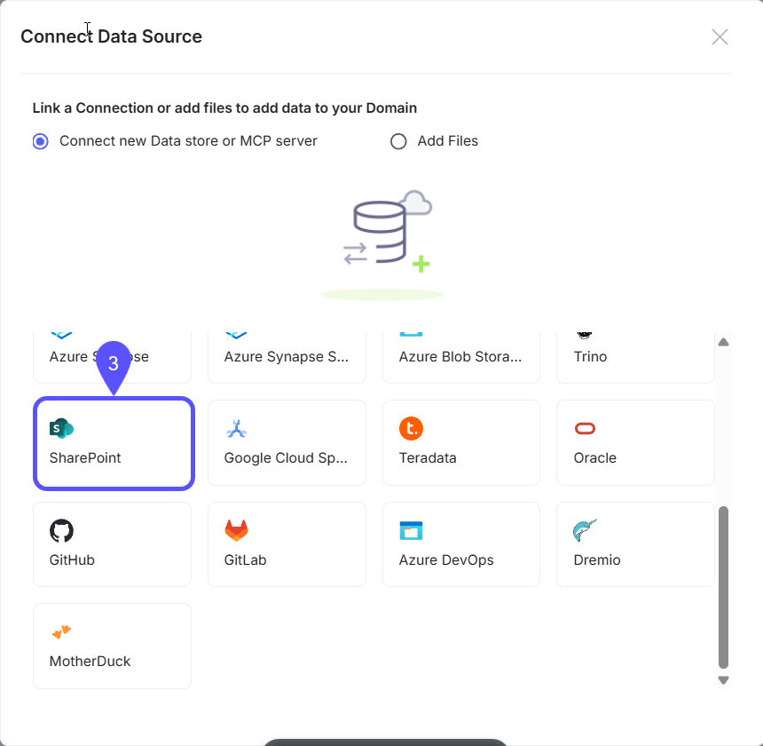
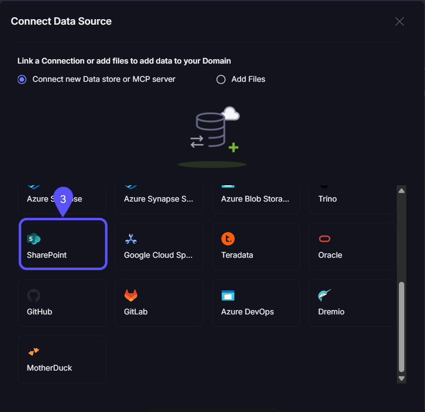
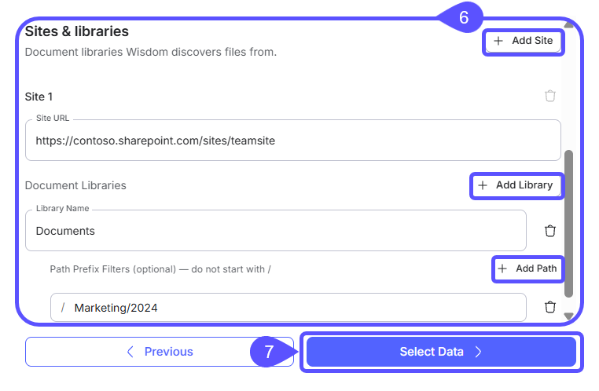
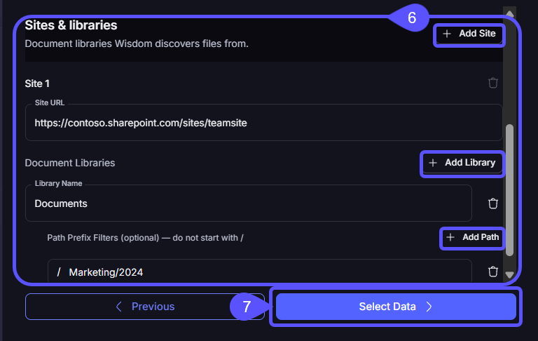

WisdomAI supports connecting to Microsoft SharePoint as an unstructured data source. The SharePoint connector crawls files from your SharePoint sites and enables multi-site ingestion of diverse file formats, including PDFs, spreadsheets, and images, while providing granular filtering to ensure that only new or modified content is processed after the initial crawl.

## Get started

Before you begin, ensure you have the following:

- **SharePoint Online:** The connector works with SharePoint Online (part of Microsoft 365). On-premises SharePoint Server is not supported.
- **SharePoint Site URLs:** The full URLs of the sites you want to connect (e.g., `https://contoso.sharepoint.com/sites/teamsite`).
- **Azure AD permissions**: The connector requires the following Microsoft Graph API application permissions granted on your Azure AD tenant:
  - `Sites.Read.All`: Read items in all site collections.
  - `Files.Read.All`: Read all files that the app has access to.
- **Authentication:** An Azure AD app registration with a client secret (Service Principal).

## Authentication methods

WisdomAI authenticates with your own Azure AD app registration (Service Principal). This gives you full control over the app and its permissions.

1. In the [**Azure Portal**](https://portal.azure.com), navigate to **Azure Active Directory** \> **App registrations** \> **New registration**.
2. Register a new application (e.g., "WisdomAI SharePoint Connector").
3. Note the **Application (client) ID** and **Directory (tenant) ID** from the **Overview** page.
4. Navigate to **Certificates & secrets** \> **New client secret**.
5. Create a secret and copy the **Value** immediately; it will not be shown again.
6. Navigate to **API permissions** \> **Add a permission** \> **Microsoft Graph** \> **Application permissions**.
7. Add the following permissions:
   - `Sites.Read.All`
   - `Files.Read.All`
8. Click **Grant admin consent** to approve the permissions for your tenant.

You will need the following values when configuring the connection in WisdomAI:

| Field | Description |
| :-- | :-- |
| Client ID | The Application (client) ID from your app registration |
| Tenant ID | The Directory (tenant) ID of your Azure AD tenant |
| Client Secret | The client secret value you generated |

## Setting up the connection

Follow these steps to establish the connection within WisdomAI:

1. In your WisdomAI domain, open the **Overview** tab and click **Add Data Source**.
2. Select **Connect new Data store or MCP server**, then click **Add Data Source**.

<Frame>
  
  
</Frame>

3. On the **Connect Data Source** screen, select **SharePoint**.

<Frame>
  
  
</Frame>

4. Enter a descriptive **Connection name** (for example, `SharePoint Connection`).
5. Under **Authentication**, enter the **Tenant ID**, **Client ID**, and **Client Secret** from your Azure app registration.

<Frame>
  
  
</Frame>

6. Under **Sites & libraries**, configure the SharePoint content to crawl:
   - Enter the **Site URL** for Site 1 (for example, `https://contoso.sharepoint.com/sites/teamsite`).
   - To include additional sites, click **Add Site**.
     <Note>
       You can add multiple sites to a single connection.
     </Note>
   - (Optional) Click **Add Library** and enter a **Library Name**. If no libraries are specified, all libraries in the site are included.
   - (Optional) Click **Add Path** and enter a path prefix (for example, `Marketing/2024`) without a leading `/`.
7. Click **Select Data**.

<Frame>
  
  
</Frame>

8. After the connection is created, add it as a data source to your domain. WisdomAI will begin crawling the configured SharePoint sites.

## Configuration reference

This section details the parameters used to define the scope of your data connection.

### Sites

Each connection can include one or more SharePoint sites. At least one site is required.

| Field | Required | Description |
| :-- | :-- | :-- |
| **Site URL** | Yes | The full URL of the SharePoint site (e.g., `https://contoso.sharepoint.com/sites/teamsite`). |
| **Document Libraries** | No | Optionally restrict which document libraries within the site are crawled. |

### Document libraries

Within each site, you can optionally specify which document libraries to crawl. If none are specified, all document libraries in the site are included.

| Field | Required | Description |
| :-- | :-- | :-- |
| **Library Name** | Yes | The name of the document library (e.g., `Documents`). |
| **Path Prefix Filters** | No | Optionally restrict which folders within the library are crawled. |

### Path prefix filters

Within each document library, you can optionally specify folder path prefixes to scope the crawl. If none are specified, all files in the library are included.

- **Formatting:** Do **not** include a leading `/`. Use `Reports/Q1`, not `/Reports/Q1`.
- **Case-Sensitivity:** Filters are case-insensitive (e.g., `Marketing` matches `MARKETING`).
- **Matching:** Filters match on prefix. `Marketing` will match `Marketing/file.pdf` and `Marketing/2024/report.pdf`.
- **Multiple Filters:** You can add multiple filters per library. A file is included if it matches **any** configured filter.

**Example configuration**:

```txt
Site: <https://contoso.sharepoint.com/sites/marketing>
  Library: Shared Documents
    Path Filter: Campaigns/2024
    Path Filter: Brand Guidelines
  Library: Reports
    (no path filters — all files in this library are crawled)
```

## Troubleshooting

<AccordionGroup>
  <Accordion title="Authentication failed">
    - Verify that the **Client ID**, **Tenant ID**, and **Client Secret** are correct and have not expired.
  </Accordion>

  <Accordion title="Connection validates, but no files were crawled">
    - Confirm the Site URL is correct and accessible. Ensure the **Site URL** points to a specific site, not the root SharePoint domain.
    - Verify the **Library Name** matches the SharePoint library exactly.
    - If using path prefix filters, verify the paths exist and do not start with `/`.
    - Ensure the Azure AD app's permissions (`Sites.Read.All`, `Files.Read.All`) have been granted admin consent.
  </Accordion>

  <Accordion title="Specific inaccessible sites">
    - The app may authenticate successfully but lack access to certain sites. Verify that your Azure AD app permissions are tenant-wide (admin-consented), not scoped to specific sites only.
  </Accordion>

  <Accordion title="Admin consent cannot be granted">
    - The user granting consent must have the **Global Administrator** or **Privileged Role Administrator** role in Azure AD.
    - If your organization restricts app consent, contact your Azure AD administrator.
  </Accordion>
</AccordionGroup>

## Next steps

<CardGroup cols={2}>
  <Card title="Export to Google Sheets" icon="table" href="/integrations/google-sheets">
    Pull live WisdomAI dashboard data directly into Google Sheets with the WisdomAI add-on.
  </Card>

  <Card title="Connect to Slack" icon="slack" href="/integrations/connect-to-slack">
    Learn how to connect WisdomAI to Slack.
  </Card>
</CardGroup>