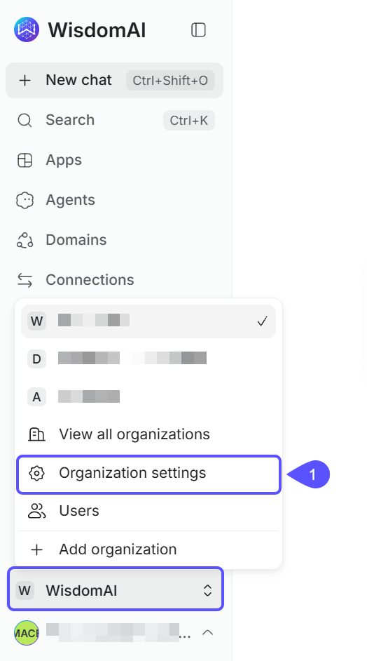
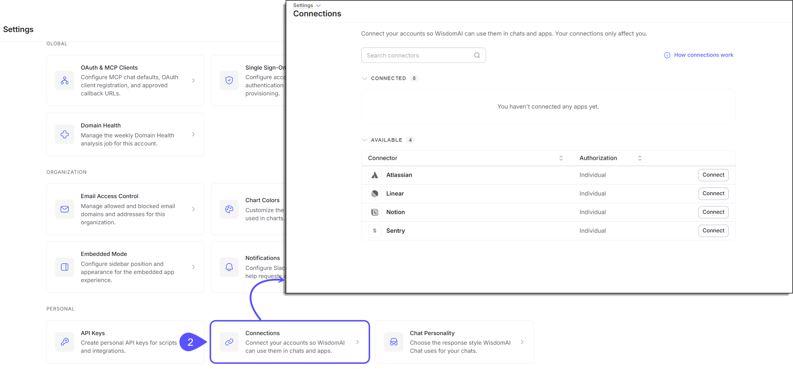
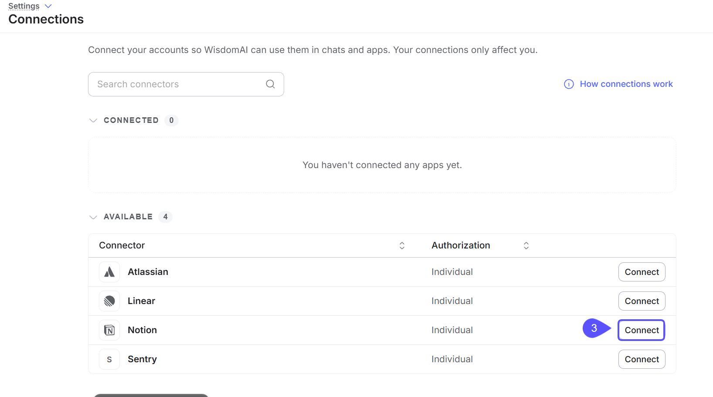
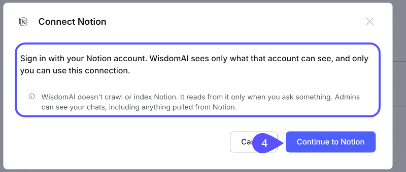
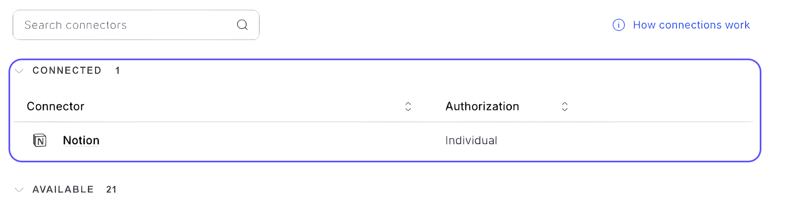
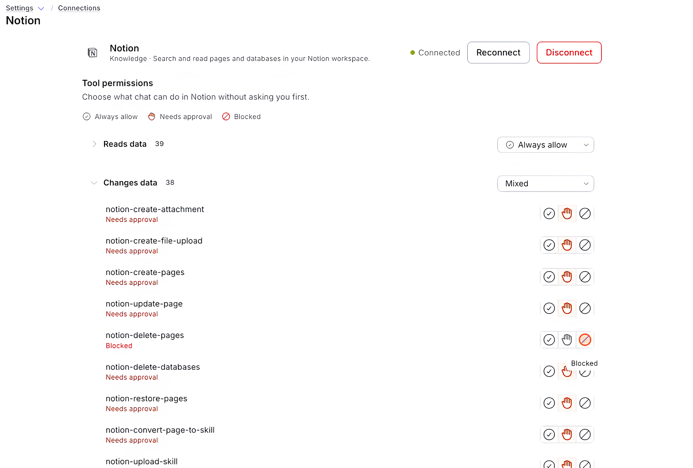
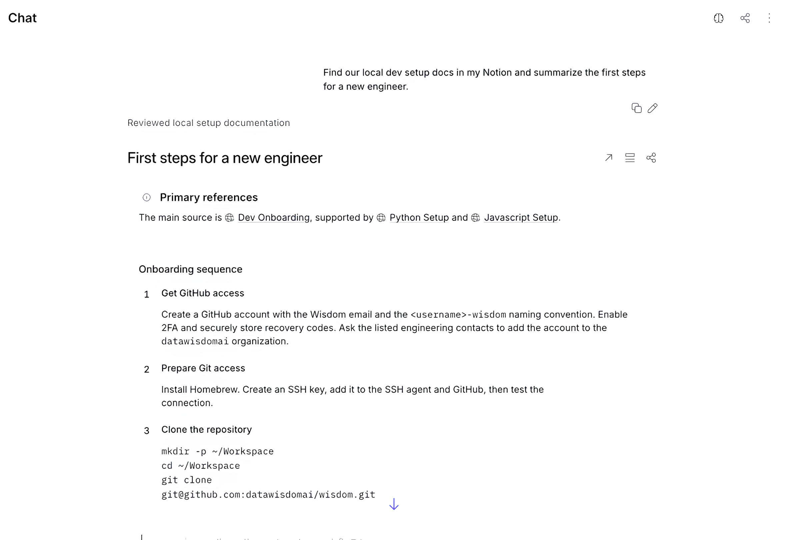

Personal connections let you link your own apps, such as Gmail, Google Calendar, Linear, Atlassian, and Notion, so WisdomAI can use them when you chat. WisdomAI signs in with your account, sees only what your account can see, and no one else can use your connection. You can also block individual tools, so chat never gets access to actions you don't want it to take.

## Individual and organization connectors

The **Connections** page lists the apps you have connected and the apps available to you. Each connector has an authorization type:

| Authorization | What it means |
|---|---|
| Individual | You sign in with your own account. WisdomAI sees only what that account can access, and only you can use it. |
| Organization | An admin set up the connector for your organization. You still sign in with your own account to use it. |

<Note>
  Admins choose which connected apps (MCP and OAuth connectors) appear for your organization.
</Note>

## Privacy

WisdomAI doesn't crawl or index your individual connections. It reads from them only when you ask something. Admins can see your chats, including anything pulled from connected apps.

To read this summary in the product, click **How connections work** on the **Connections** page.

## Connect an app

This example connects Notion. The steps are the same for other apps.

1. Open the **Organization** menu and click **Organization settings**.

<Frame>
  
</Frame>

2. Click **Connections** to open the connections page.

<Frame>
  
</Frame>

3. Click **Connect** on the connector you want. To use your own account, choose the connector with Individual authorization.

<Frame>
  
</Frame>

4. Read the dialog. It states what WisdomAI will be able to see. Click **Continue to Notion**.

<Frame>
  
</Frame>

5. Sign in and approve access in the sign-in window that Notion opens.

When the connection completes, the app moves to the **Connected** section at the top of the page.

<Frame>
  
</Frame>

## Manage tool permissions

Click a connected app to open its page. The page shows the app's status and the **Reconnect** and **Disconnect** buttons. Under **Tool permissions**, you choose what chat can do in the app without asking you first.

Each tool has one of three settings:

| Setting | What it means |
|---|---|
| Always allow | Chat can use the tool without asking you first. |
| Needs approval | Chat asks you before it uses the tool. |
| Blocked | Chat never gets the tool. |

Tools are grouped by what they do. For Notion, **Reads data** has 39 tools and defaults to Always allow. **Changes data** has 38 tools and defaults to Needs approval. Use the dropdown on a group to set all of its tools at once. The dropdown shows "Mixed" when the tools in a group have different settings.

To stop chat from deleting your Notion pages, expand **Changes data** and set `notion-delete-pages` to Blocked.

<Frame>
  
</Frame>

<Note>
  Permissions apply to your connection only. Other people are not affected.
</Note>

## Ask chat about your connected app

Start a new chat and ask a question about content in the connected app. For example: "Find our local dev setup docs in my Notion and summarize the first steps for a new engineer."

WisdomAI searches the app with your own access and returns an answer with links back to the pages it used. To see how WisdomAI got the answer, expand the steps at the top of the response. They list the searches and tool calls WisdomAI ran in your app.

<Frame>
  
</Frame>

## Related articles

<CardGroup cols={2}>
  <Card title="MCP server" icon="plug" href="/integrations/mcp-server">
    Connect external AI clients to WisdomAI through the MCP server.
  </Card>

  <Card title="Connect to Slack" icon="slack" href="/integrations/connect-to-slack">
    Learn how to connect WisdomAI to Slack.
  </Card>
</CardGroup>
