Describe the app you want and let WisdomAI build it. Refine the result with chat, annotations, and direct text edits.

## Before you begin

Make sure you have the following:

- A role that can create apps. Explorer roles and above qualify. See the [Access Management](/manage-account/access-management) page for more details.
- An app draws its data from your domains. Domains with well-defined metrics, synonyms, and knowledge produce noticeably better apps.

## Create an app

Describe the app you need and WisdomAI builds it in the background.

1. Open Apps. Click **Apps** in the sidebar. Apps and dashboards share this list.
2. Click **New App**. A composer opens and asks you to describe the app.
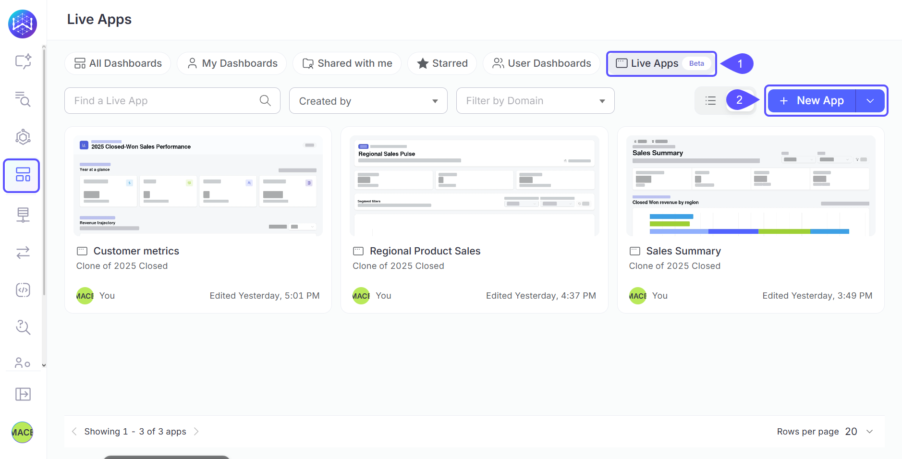
3. Describe the app. Say who it is for, what job it does, and the metrics, breakdowns, and views you care about.
4. Let it build. WisdomAI answers the data questions first, then generates and validates the app. You can leave the page; generation continues on the server, and the app picks up where it left off when you come back.
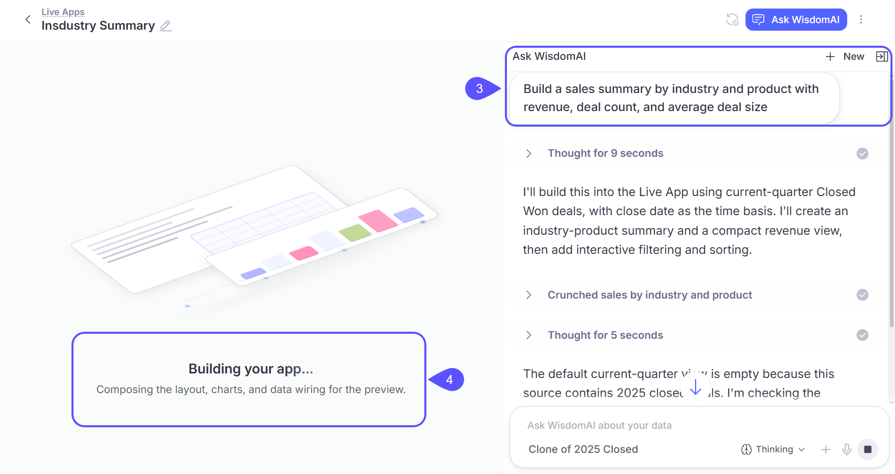
5. Review the result. Check the numbers, then refine anything you want changed.
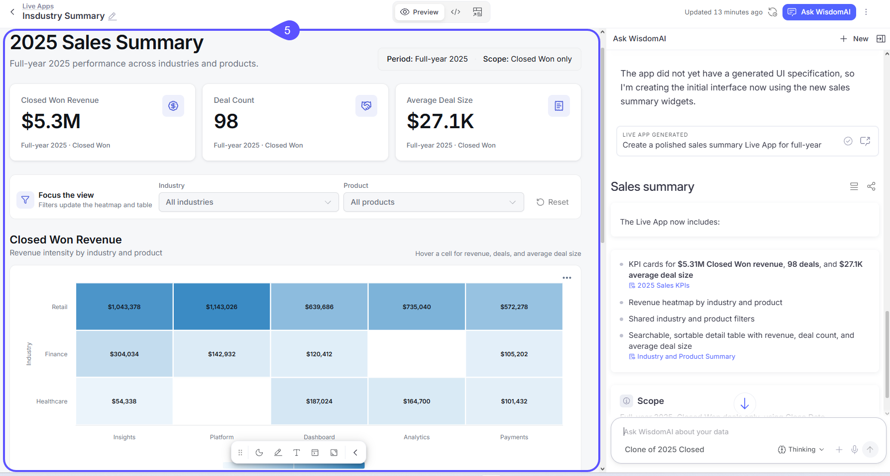
    <Note>
      There is no notification when generation finishes. Return to the app to see the result.
    </Note>

## Start from a suggested app idea

Pick an app idea suggested for your domain instead of writing a prompt from scratch.

1. Open the home page and select **Build**.
2. Select the domain for your app.
3. Choose an idea under **Suggested apps for you**, or describe your own app.

<Note>
  Ideas under **Build** help you create a new app. Suggestions under **Ask** open existing content.
</Note>

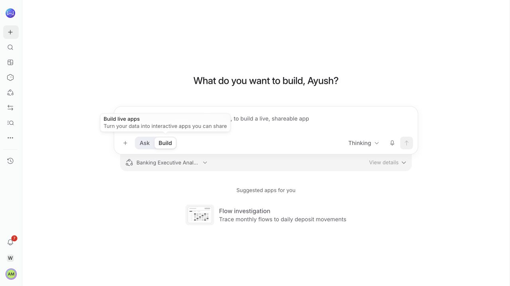

## Write a prompt that works

A focused, specific prompt produces a more useful app than a generic one.

- Name the audience and the job. "A pipeline review for the weekly sales leadership meeting" produces a more focused app than "sales dashboard".
- Use the metric names and terms your domain defines.
- Say how the app should be organized if you have an opinion, such as sections, tabs, or a hero metric at the top.
- Attach a reference image if you have a target look. WisdomAI uses attached images as visual reference during generation.

## Refine the app

Editors have three ways to change an app.

- Chat. Open **Ask WisdomAI** and describe the change. Use chat for anything broad, like adding a section or changing what a chart shows.
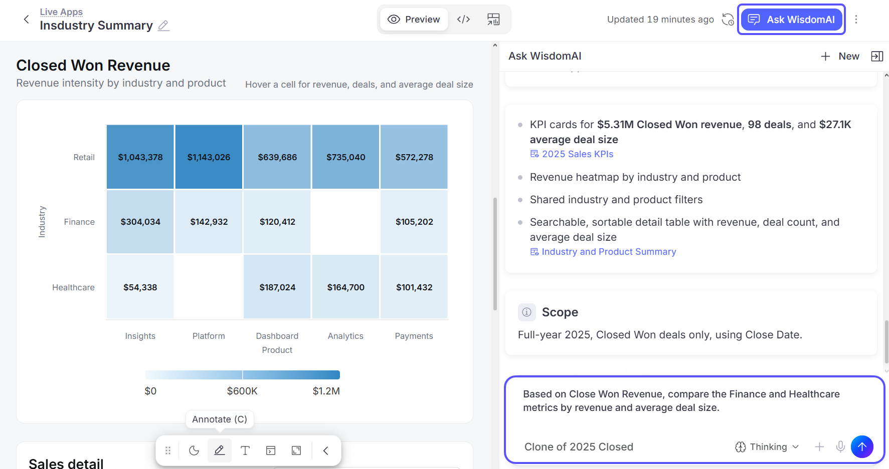
- Annotate. Click **Annotate** in the toolbar (or press **C**), click an element, and leave an instruction for that element only. Use it for targeted fixes, like making one KPI the hero metric, without touching the rest of the app.
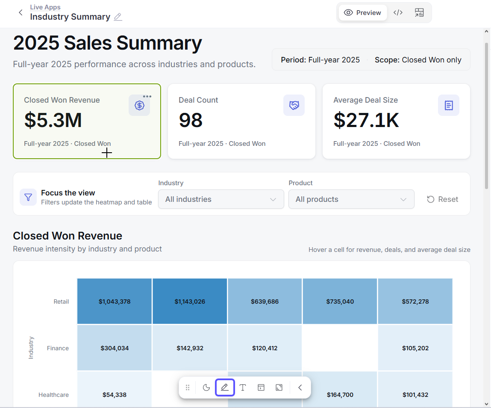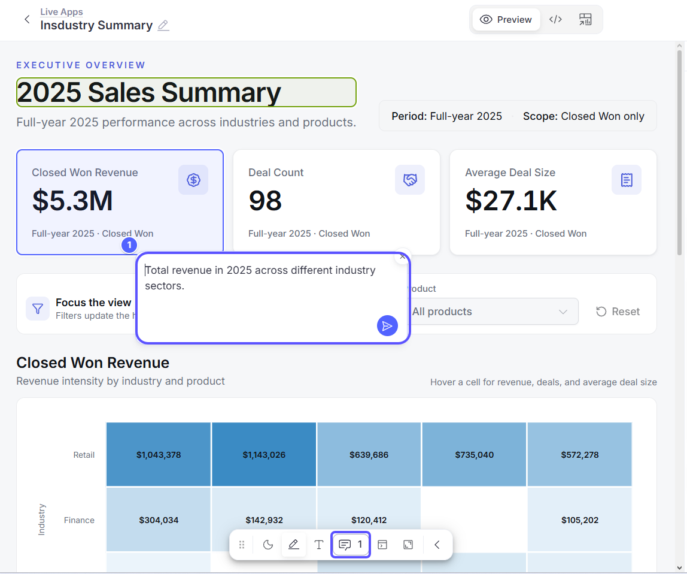
    <Note>
      Viewers can annotate and chat too. For them it opens a scoped conversation about the app; changing the app itself stays with editors.
    </Note>
- Edit text. Click **Edit text** (or press **T**) to change titles and labels in place, then click **Save edits**. Text that comes from your data is marked **From app data** and is changed through chat or annotations instead.
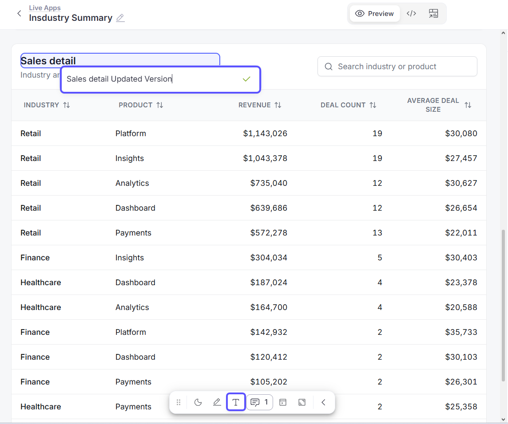

If an app fails to render after a change, editors see **Fix with AI**, which sends the failure details to chat and asks WisdomAI to repair the app. You can also restore an earlier state at any time with **Version history** in the app menu.

## Publish or discard a draft

An app can have unpublished changes. Editors can review the draft while viewers continue seeing the last published version.

Choose **Publish** to make the draft available to viewers. Choose **Discard** to remove the unpublished changes and keep the published version.

## Switch views

The control at the top of an app has up to three views.

- **Preview**: Shows the app itself.
    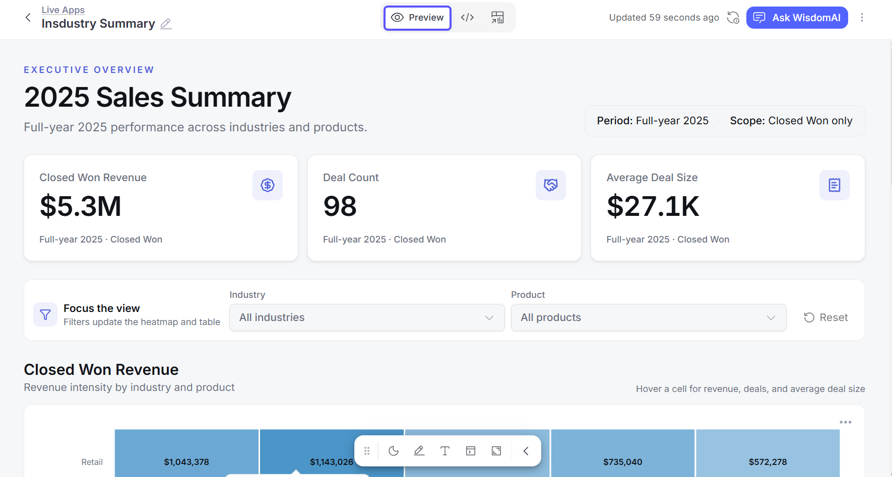
- **Code**: Shows the generated React source. Every app is real, inspectable code.
    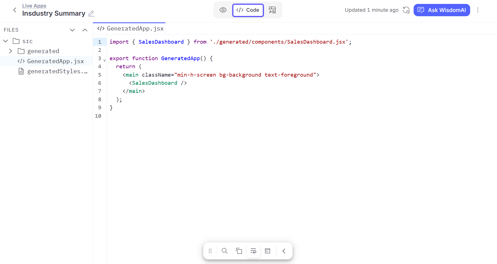
- **Sources**: Shows the widgets that serve the app's data, laid out as plain tiles.
    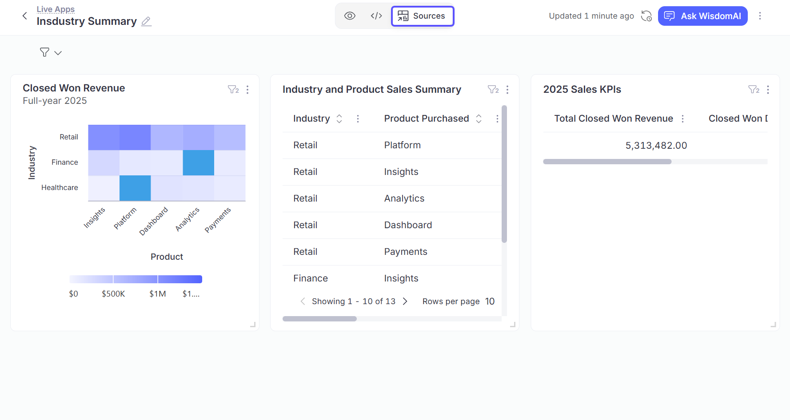

## Rename, organize, duplicate, or delete

Manage an app's name, location, and lifecycle from its menu.

- Rename an app by clicking its title in the builder and typing.
- Apps sit in the same folders as dashboards. Use **Move** in the app menu to file one, and star it to pin it to your Starred view.
- **Duplicate** in the app menu creates a copy you own.
- **Delete** removes the app. This cannot be undone.

## Migrate a dashboard

Turn an existing dashboard into a Live App from the dashboard itself.

1. Open the dashboard and select **Migrate to Live App** in the top bar.
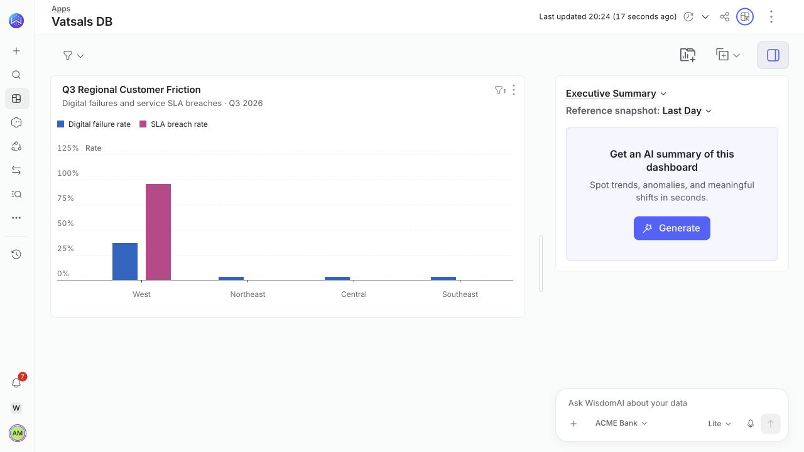
2. Review the generated app. The original dashboard remains available.
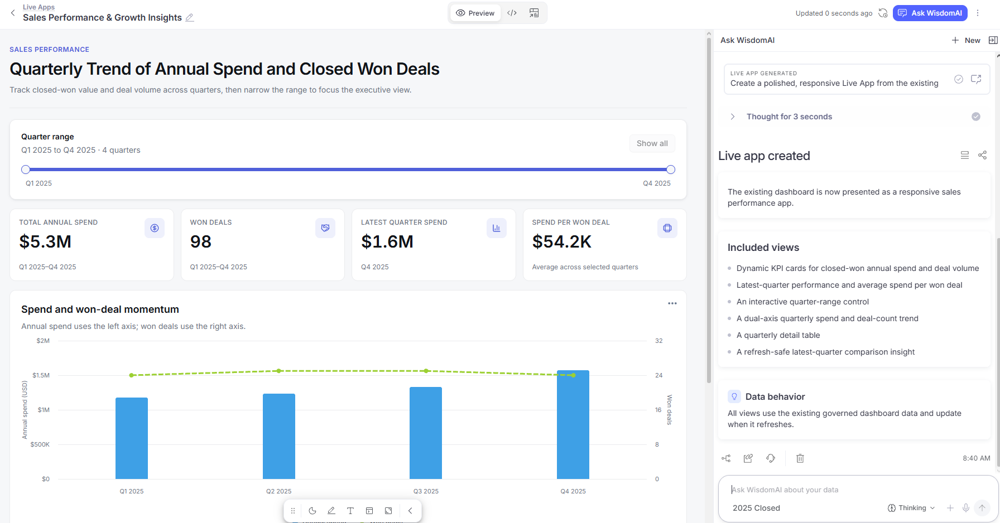

Dashboards using Filters V2 can migrate with their filters. Dashboards using Filters V1 must first move to Filters V2 and recreate their filters, or remove the old filters. The dashboard's widgets must belong to one domain.

Summary and text widgets are left out of migration. Review the new app for any content you need to add.

## Next steps

<CardGroup cols={2}>
  <Card title="See the Data Behind a Live App" icon="database" href="/live-apps/data-and-trust">
    Inspect widgets, read the SQL, and manage freshness.
  </Card>
  <Card title="Share a Live App and Manage Access" icon="unlock" href="/live-apps/share-and-access">
    Roles, organization-wide sharing, and exports.
  </Card>
</CardGroup>