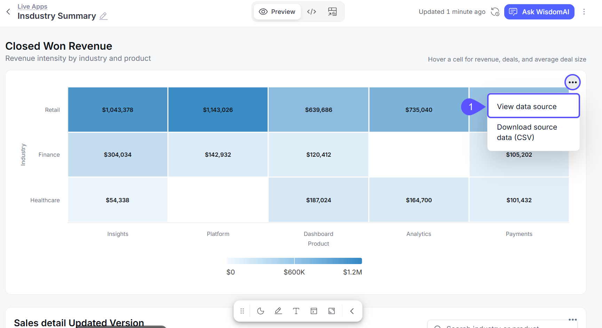
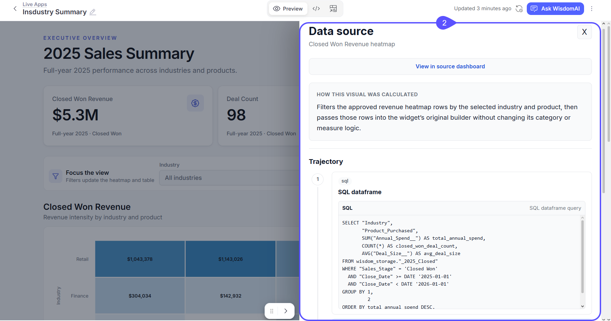
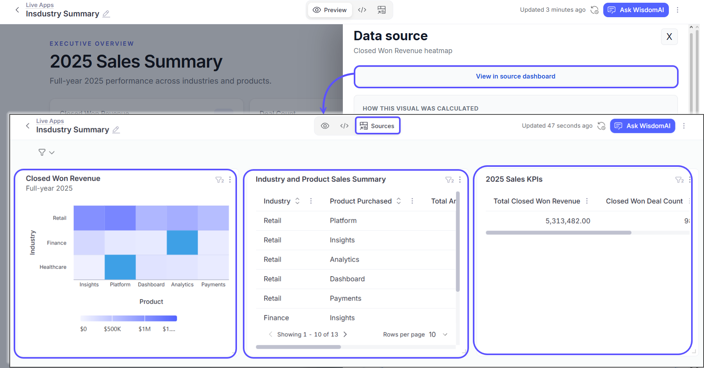
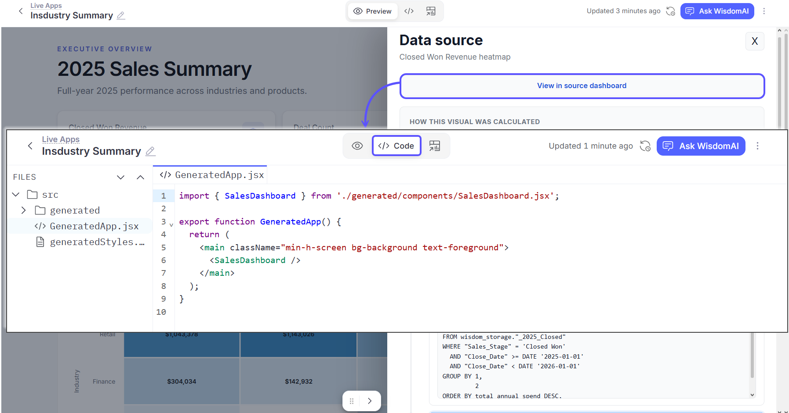
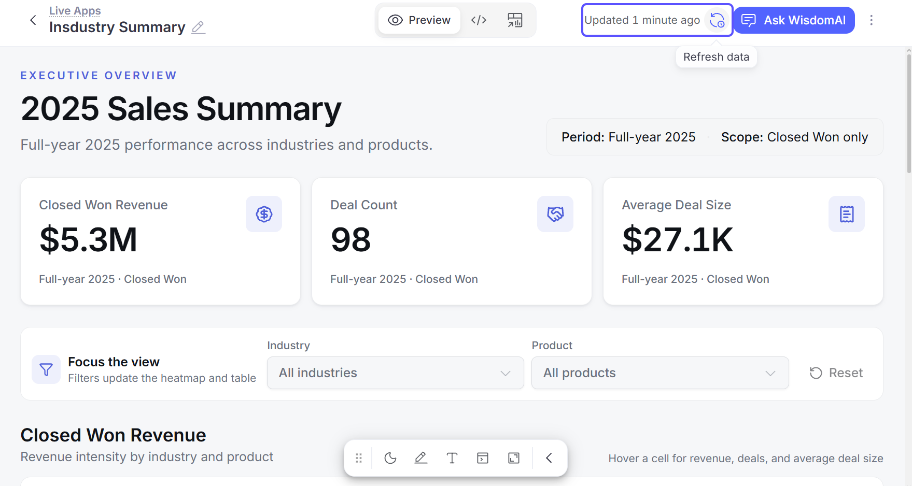
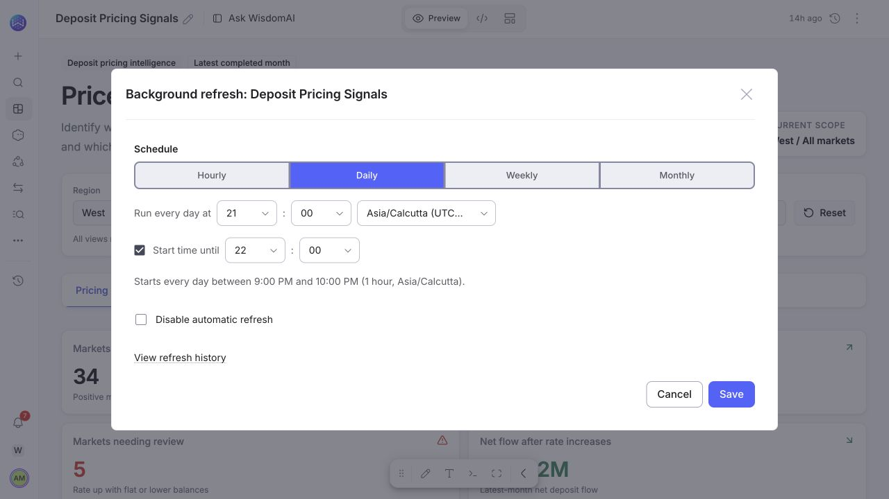
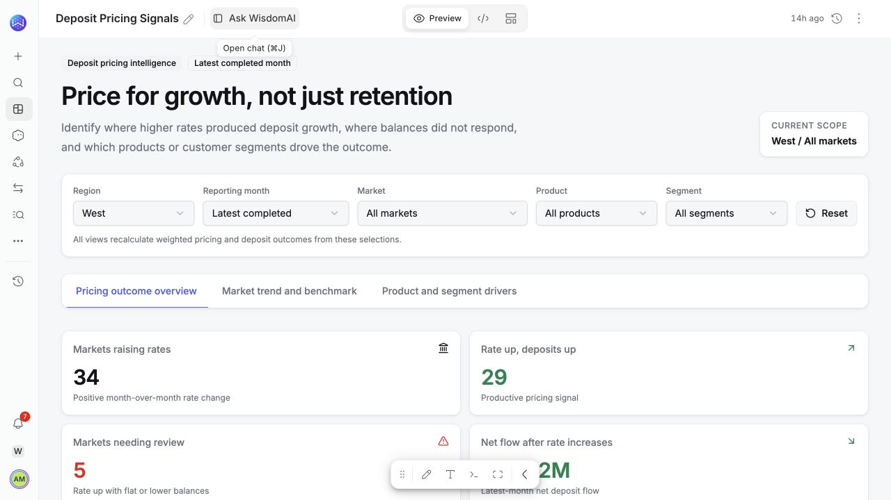

Every number in a Live App traces back to a governed query. Inspect any widget, open the source tiles, and control how fresh the data is.

## Inspect a widget

To inspect a widget, follow these steps:

1. Open the widget's menu. Hover over a chart, KPI, or table and click its three-dot menu. Click **View data source.**

2. The Data source panel opens with everything behind that widget.

    The panel shows the following.

    - **How this visual was calculated.** A plain-English summary of the widget's logic.
    - **Trajectory.** The steps that produced the data, including the exact SQL that ran.
    - **Data preview.** The first rows of the widget's data.
    - **View in source dashboard.** A link that jumps to the same widget in the Sources view.

    The same menu has **Download data (CSV)**, which exports what the widget is currently showing.

## The Sources view

Every app is served by a set of widgets, the same kind of object that powers dashboard tiles. Switch the view control at the top of the app to **Sources** to see them as plain tiles. Use it to confirm whether something odd lives in the data or in the generated interface.

## The Code view

Switch to **Code** to read the app's generated React source, with search and **Copy code** in the toolbar. Apps run in a sandbox with no network access of their own, so an app can only show data served through WisdomAI.

## How data stays fresh

A Live App serves the latest refreshed results for its widgets. Opening an app does not run new warehouse queries, so apps open fast.

- The top of the app shows when the data was last updated, for example "Updated 2 hours ago".
- Data refreshes automatically on a daily schedule.
- Click **Refresh data** in the top bar to re-run the app's queries on demand.

### Set the refresh schedule

Editors can set an app's automatic refresh schedule.

1. Open the app's menu and choose **Background refresh**.
2. Choose **Hourly**, **Daily**, **Weekly**, or **Monthly** and set the timing and time zone.
3. Select **Save**. To stop scheduled refreshes, select **Disable automatic refresh** and save.
4. Open **View refresh history** to inspect previous refreshes.

Use **Refresh data** in the top bar for an immediate refresh.

## Filter an app

Use the app's date, region, product, or other filter controls to narrow the analysis. Each person's selections apply to their own view.

When building or editing an app, describe what the filter should change.  
**Example:**

*Add a region filter. Recalculate deposit balances and pricing outcomes for the selected region.*

Column filters narrow the data served to the app. Query parameters rerun the underlying calculation when the selection needs to change its inputs. Filtering only the rows loaded in the browser can miss matching data. The app should use the appropriate data filter.

## Data security

Queries run as the viewer. Row-level and column-level security from your domains apply inside apps exactly as they do in chat and on dashboards. Two people can open the same app and each sees only the data their permissions allow.

## Limits

- A widget loads up to 10,000 rows by default. Larger results are marked incomplete, and filters inside the app work on the loaded rows. The limit is configurable per deployment, and removing this restriction is coming soon.
- Apps are viewable on mobile. Building and editing work best on desktop.

## Next steps

<CardGroup cols={2}>
  <Card title="Create a Live App" icon="pencil" href="/live-apps/create-live-app">
    Write a prompt and refine the result.
  </Card>
  <Card title="Share a Live App and Manage Access" icon="unlock" href="/live-apps/share-and-access">
    Roles, organization-wide sharing, and exports.
  </Card>
</CardGroup>