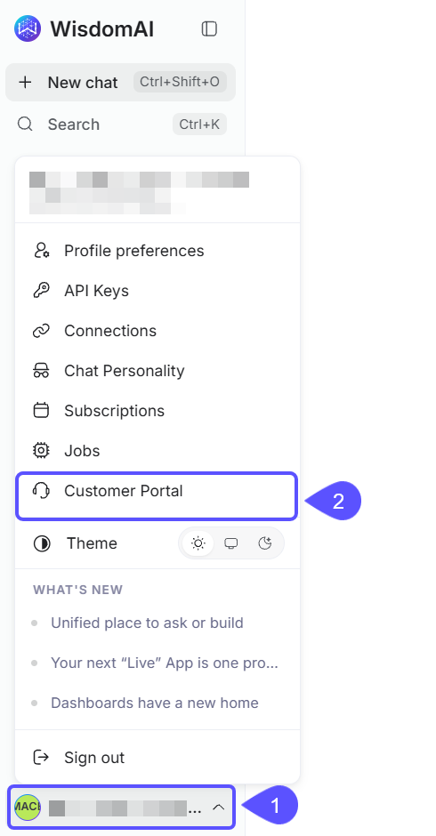
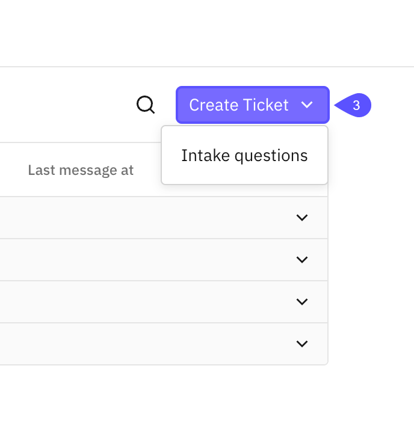
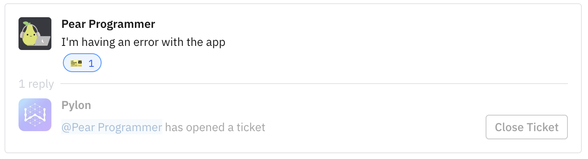

You can raise a support ticket with WisdomAI support in three ways: by email, through the Customer Portal, or from a shared Slack channel. Use the portal for bugs, data or loading errors, access problems, and how-to questions.

## Email support

Email [support@wisdom.ai](mailto:support@wisdom.ai) to reach the support team.

To help us resolve your issue faster, include:

- A clear description of the problem.
- Relevant screenshots or a short video of the issue.
- Any error messages or logs from previous runs.

## Customer Portal

You can raise a ticket without leaving WisdomAI. The Customer Portal also lists every ticket you have raised, so you can track status and replies in one place.

### Create a ticket

1. In the left sidebar, click your name at the bottom to open your profile menu.
2. Click **Customer Portal**. The portal opens with a list of your existing tickets.
  
3. Click **Create Ticket** at the top right of the ticket list, then select **Intake questions**.
  
4. Fill in the form and click **Submit**. To leave without submitting, click **Back to Portal**.

### Intake form fields

Name, Email, Subject, and Description are required. The other fields are optional but speed up triage. WisdomAI fills in your email from your login, and you can't edit it.

| Field | Required | What to enter |
|---|---|---|
| Name | Yes | Your name. |
| Email | Yes (prefilled) | Your WisdomAI login email. |
| Subject | Yes | One line that states the problem and where it happens. |
| Description | Yes | What you did, what you expected, what happened, and any error text. Attach screenshots with the paperclip icon. |
| Question Type | No | The kind of request, for example "Bug". |
| Priority | No | How urgent the issue is for your team. |
| % Users Impacted | No | The share of your users affected. |
| `Chat/Dashboard/App/Agent` Link(s) | No | The URL of the chat, dashboard, app, or agent with the issue. |
| Domain | No | The WisdomAI domain involved. |

<Note>
  The description editor supports bold, lists, code blocks, and attachments.
</Note> 

Paste error messages as code and add a screenshot of what you see.

### Tips for faster resolution

- Add the link. Copy the URL of the chat, dashboard, app, or agent from your browser.
- Raise one issue per ticket. Separate tickets keep status and replies clear.
- Set the priority to match the impact. Use Urgent for outages or critical security breaches, and High for issues that block work for many users.

### Track your ticket

After you click **Submit**, the ticket appears in your Customer Portal list. Click its row to read replies, or check the **Last message at** column to see when support last responded. Reply in the same ticket to add details instead of opening a new one.

## Shared Slack channel

If your organization has a shared Slack channel with WisdomAI, you can raise a ticket from it.

1. Post a message that describes your issue, or find an existing message about it.
2. React to the message with the 🎫 emoji.
  
<Tip>
  To escalate a ticket, react with the 🆘 emoji.
</Tip>
WisdomAI support replies in the message thread to confirm that the ticket is open. The reply includes a **Close Ticket** button.
