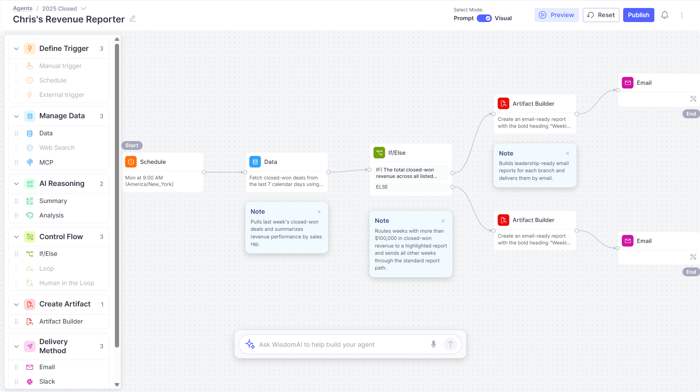
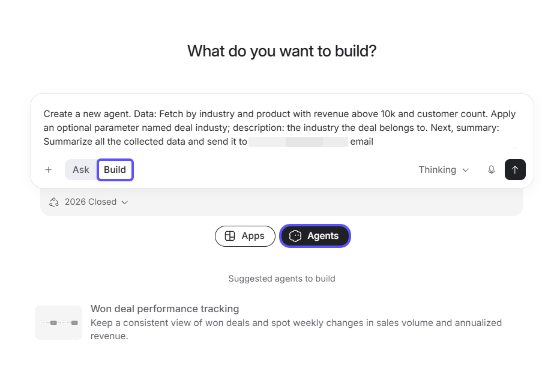
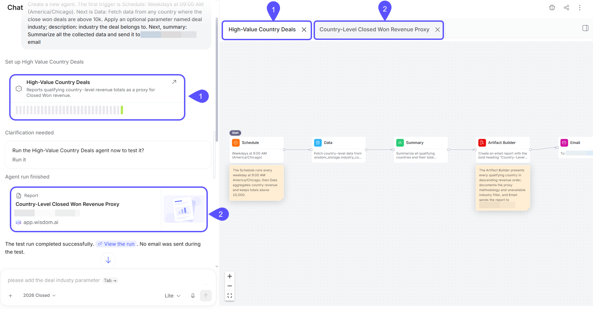

Agents are automated workflows that perform intelligent analysis autonomously. Think of an agent as a digital worker you configure once and leave running. It takes on a goal you define, pulls the data it needs from your domain context, runs the analysis, and delivers the result, without waiting for you to ask.

<Frame>
  
</Frame>

An agent can:

- **Monitor your data** continuously and alert you the moment a metric crosses a threshold.
- **Run recurring analyses** on a fixed cadence, from daily summaries to weekly reports.
- **Explain what changed** by breaking down the drivers behind a shift, not just flagging that one occurred.
- **Deliver scheduled reports** via email or Slack.

<Note>
  WisdomAI offers two ways to build an agent:

  - **Prompt Mode**, where you describe what you want, and the agent figures out the steps on every run
  - **Visual Mode**, where Ask WisdomAI generates a visual plan from your description that you review, freeze, and reuse on every run.

  Both are introduced in detail in the [Get started](#get-started) section at the end of this article.
</Note>

## Why use an agent

Beyond saving time, agents work at every scale, offering solutions from a single quick task to a full production workflow.

- **Simple to create, capable of complex work:** You describe the goal in a sentence, and the agent does the kind of multi-step work that would otherwise take hours. In Prompt Mode, a one-sentence description creates an agent. In Visual Mode, Ask WisdomAI turns a plain-language description into a multi-step workflow. The agent then handles the hard parts on your behalf: querying the right data sources, comparing results across time periods, applying conditional logic, generating natural-language summaries, and delivering the output through the right channel.
- **Agency when you want it, determinism when you need it:**  Some work is best handled by letting the agent figure out the right approach as it runs. Other work needs to produce the same result every run. Prompt Mode builds a fresh plan each time the agent runs, leaving room for the LLM to explore and adapt. Visual Mode follows a plan you reviewed and locked in once, so the same inputs produce the same outputs every time. Pick the mode that fits the work.
- **Personal workflows and production workflows:**  Agents work for one-off personal monitoring as well as shared, recurring production reports. Spin up a Prompt Mode agent in a minute to keep an eye on your own metrics. Build a Visual Mode workflow when other people depend on the result, and consistency matters. The same platform handles both ends.

## When to use an agent

Reach for an agent when work needs to happen on its own, when you want analysis delivered without you having to run it, alerts raised without you having to watch, and reports produced without you having to remember.

### Common use cases

The first three examples below show how agents can build on one another within a single scenario, escalating from a simple alert to a full root cause investigation.

<Steps>
  <Step title="Monitor for problems">
    Use an agent to watch a metric and alert you only when something goes wrong.

    - **Trigger:** Sales fall below \$100,000 in the last day.
    - **Work:** Send a list of lost deals from the last day, including region, owner, and total value.

    A sales manager is alerted only when performance dips — no daily report to check, no threshold to remember.
  </Step>
  <Step title="Track significant changes">
    Use an agent to detect meaningful fluctuations in either direction, then explain what drove them.

    - **Trigger:** Daily sales move outside a 10% range compared to the same day last week.
    - **Work:** Compare today's lost and won deals against last week's, segment the difference by region, deal size, and sales rep, and surface the segments contributing most to the change.

    The alert from the previous step becomes a starting point for action.
  </Step>
  <Step title="Root-cause analysis">
    Use an agent to investigate why a metric changed, not just that it changed.

    - **Trigger:** Daily sales drop more than 15% week-over-week.
    - **Work:** Cross-reference the lost deals with recent product changes, support tickets from those accounts, sales rep activity logs, and pipeline movement to surface the most likely root causes.

    The segmentation from the previous step is now connected to other systems to produce a working hypothesis, not just a breakdown.
  </Step>
</Steps>

The steps above show how agents handle one scenario in depth. Agents also fit a wide range of recurring patterns, both reactive and proactive. Here are some typical examples.

| Use Case | Example | Best mode |
| --- | --- | --- |
| **Pipeline check** | Flag deals stuck in the same stage for 7\+ days, post to Slack each morning. | Prompt |
| **Anomaly monitoring** | If DAU drops 15% vs the 7-day average, post to a channel with context on what drove it. | Prompt |
| **Team summary** | Summarise this week's support tickets — volume, top categories, resolution trends — and email it Friday. | Prompt |
| **Scheduled report** | Pull last week's product usage by customer tier and email a summary of the biggest movers to the customer success team every Monday. | Both |
| **Multi-source exec report** | Pull revenue, pipeline, and support data from three sources, include an incidents section only if P0/P1s occurred, format as a branded PDF, deliver Monday at 7am. | Visual |
| **Tiered alerting** | Monitor app performance, billing, and support, route to different channels depending on which combination of signals fires. | Visual |
| **Personalised reports at scale** | Generate weekly performance reports for 50 regional managers, each filtered to their region. | Visual |

## Get started

WisdomAI offers two ways to build an agent. Choose the one that fits how you work.

### [Prompt Mode](/setting-up-wisdom-ai/agents/tutorial-create-agent)

Prompt Mode is the fastest way to get started. You write a plain-language description of what the agent should do when it runs, test it, and the agent is ready. This mode works well for **straightforward monitoring tasks**, such as tracking a metric, flagging a threshold, or sending a weekly summary.

### [Visual Mode](/setting-up-wisdom-ai/agents/visual-mode)

Visual Mode gives your agent a high-level plan to follow. Describe what you want in plain language, and **Ask WisdomAI** generates the plan as a visual workflow of connected nodes — fetching data, running analysis, applying conditions, and delivering the result. You review the plan, refine it on the canvas if needed, and freeze it.

On every run, the agent refers back to this locked plan. Because the plan is explicit, execution stays consistent across runs, and you can model far more complex workflows than a single prompt could express. That makes Visual Mode the right choice for production workflows where both consistency and complexity matter.

You can also call on Ask WisdomAI again at any point to modify an existing workflow, for example, to add a step, change a condition, or swap a data source.

### Create agent from chat

You can create an agent without leaving chat. Describe what you want, and chat builds the agent in the conversation.

1. On the new chat screen, click **Build** and select **Agents**.
2. Describe the agent: the data to fetch, any parameters, when it should run, and where to send the results. If you leave out the schedule or the delivery, chat chooses a schedule and asks where to send the results.
3. Send your request.

<Tip>
  Not sure where to start? Pick one of the **Suggested agents to build** below the chat box.
</Tip>

<Frame>
  
</Frame>

Chat then does the following:

1. It shows the new agent as a card (1). Click the card to open the agent beside the chat.
2. It asks whether to run the agent now to test it. Select **Run it** to watch the run in the conversation. The report appears as a card (2), and no email is sent during the test.

<Frame>
  
</Frame>

For everything chat can do with agents, see [Manage agents from chat](/setting-up-wisdom-ai/agents/manage-agents#manage-agents-from-chat).

## Next steps

<CardGroup cols={2}>
  <Card title="Create an Agent" icon="robot" href="/setting-up-wisdom-ai/agents/tutorial-create-agent">
    Learn the basics of setting up a new AI agent for your data.
  </Card>

  <Card title="Build an Agent in Visual Mode" icon="diagram-project" href="/setting-up-wisdom-ai/agents/visual-mode">
    Step-by-step guide to building your first Visual Mode agent.
  </Card>
</CardGroup>