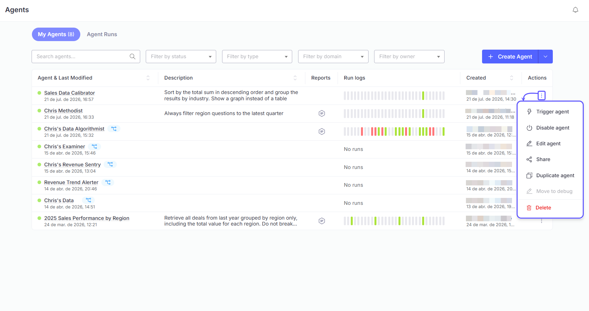
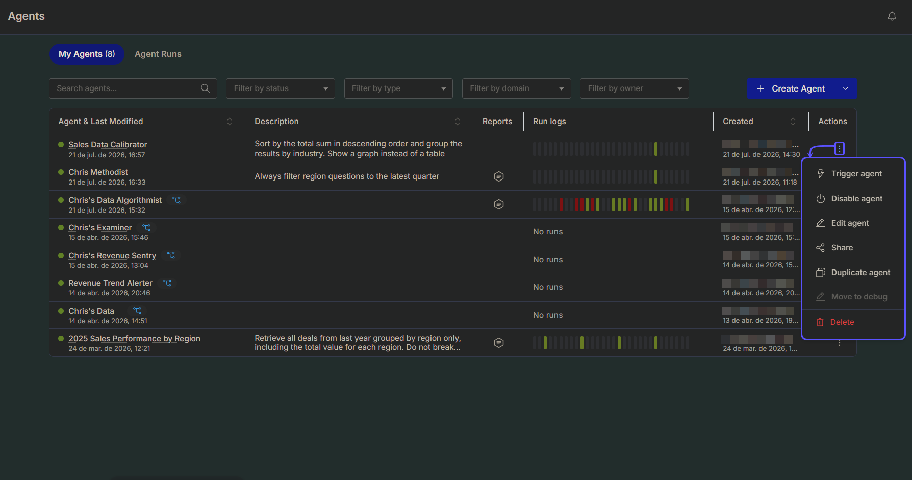
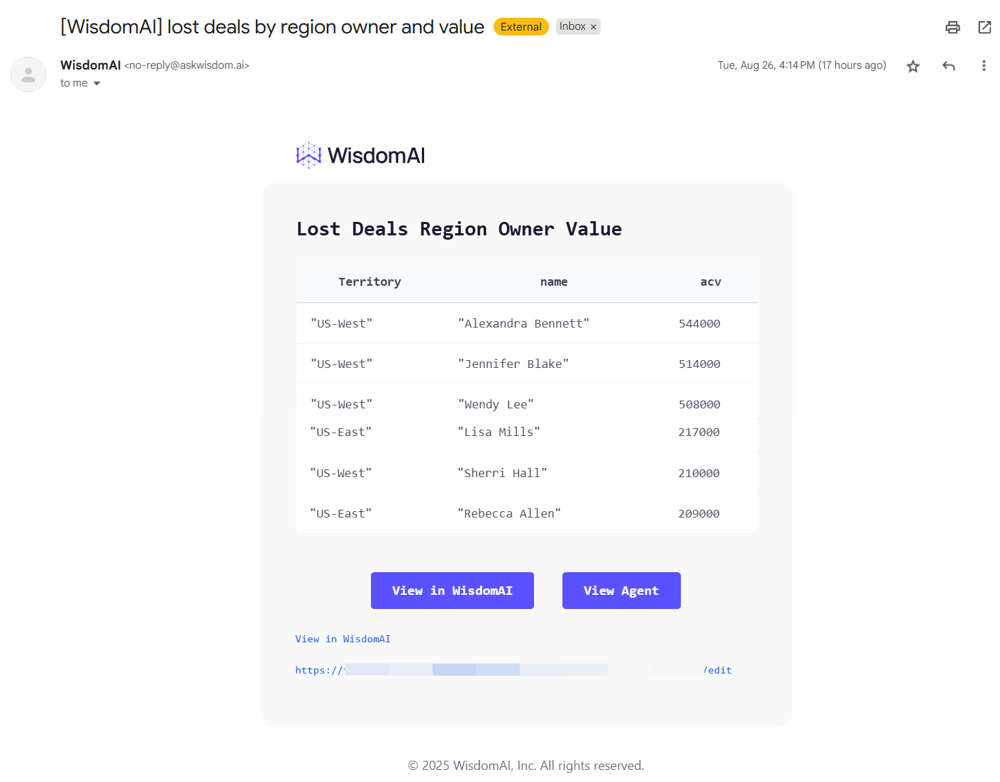
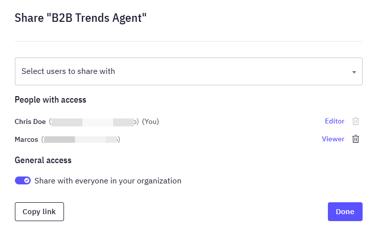
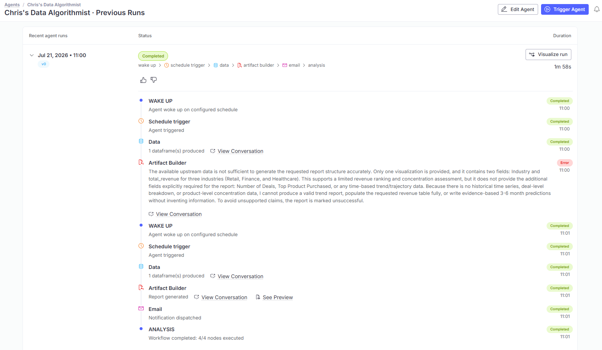
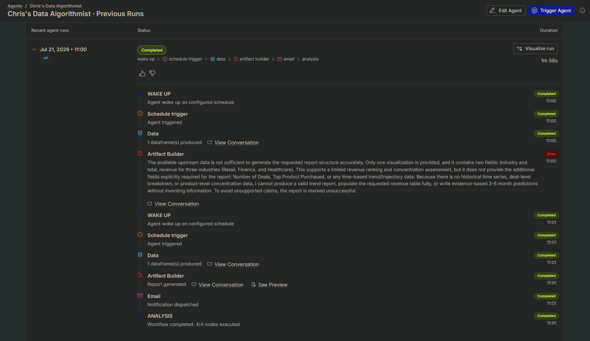
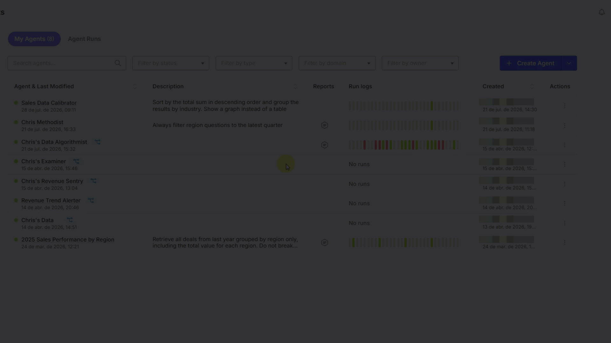
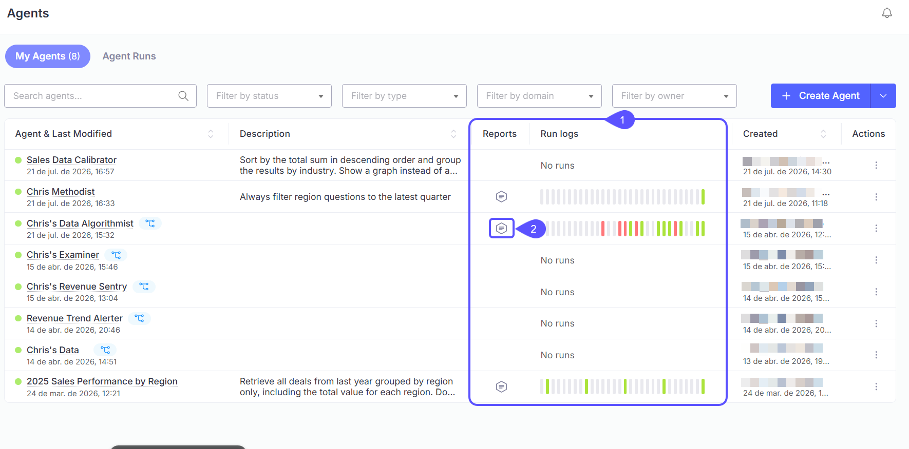
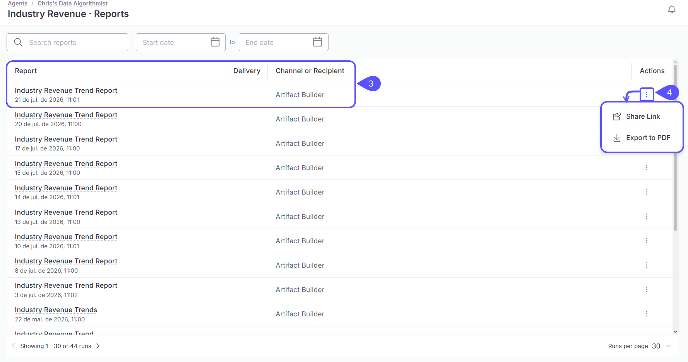

Once an agent is created, you stay in control of it. You can run it on demand, edit its trigger or schedule, review its previous runs and reports, or delete it. There are two ways to manage your agents:

- **From chat**: Skip the menus and ask in plain language, directly in a conversation. You can create, find, inspect, update, run, and delete agents, and ask about their previous runs. See [Manage agents from chat](#manage-agents-from-chat).
- **From the UI**: Use the main **Agents** page to manage every agent you have access to, with a three-dot menu of actions on each one. Here you can also share agents, enable or disable them, and move them to debug. See [Manage agents from the UI](#manage-agents-from-the-ui).

## Manage agents from chat

You can create, find, inspect, update, delete, and run agents from chat. You can also bring previous runs into the conversation and ask about their analysis, results, or failures.

Here are some day-to-day examples you can try:

- Create an agent from the current analysis: "Send me this summary every Monday at 8am, Asia/Kolkata."
- Find and inspect an agent: "Show me the regional deposit agent and explain what it does."
- Update an agent: "Change the regional deposit agent to run every Friday at 9am."
- Run an agent: "Run the regional deposit agent for North."
- Bring a previous run into chat: "Show me the regional deposit agent's latest run and its report."
- Investigate runs: "Why did yesterday's run fail?" or "Compare the latest two runs."
- Delete an agent: "Delete the regional deposit agent."

Chat can use the agent's configuration, previous runs, step conversations, and reports that you have access to. You can ask follow-up questions without restating the analysis.

A test run sends no report to subscribers unless you ask for delivery.

## Manage agents from the UI

Every agent appears in a list on the main **Agents** page. From this page, you can manage all the agents you have access to.

To manage an individual agent, locate it in the list and click the **three-dot menu (...)** under the **Actions** column. A dropdown menu will appear with the following options:

- **Trigger agent**: Manually runs the agent’s entire workflow. The agent will evaluate its trigger (if enabled) and, if the conditions are met (or if the trigger is disabled), run the full analysis and send a notification.
  Once you get the notification, you will be able to:
  - **View in WisdomAI**: it takes you to the chat window.
  - **View Agent**: it takes you to the agent configuration page.

- **Enable agent / Disable agent**: Toggles the agent between the **Active** and **Inactive** states. Disabling an agent stops it from running on its schedule; enabling it resumes normal runs and notifications. See [Agent states](#agent-states) below.
- **Edit agent**: Opens the canvas for Visual agents, allowing you to modify the agent's name, trigger, work description, or schedule.
- **Share**: Allows you to share the agent with other users for collaboration.
  - **Manage access**: grant **Editor** or **Viewer** access for that agent.
  - **Manage general access**: share it with everyone in your organization.
    
- **Duplicate agent**: Creates a copy of the agent that you can edit independently, without affecting the original.
- **Move to debug**: Switches the agent to the **Debug** state. The agent still runs on its schedule and produces output, but doesn't send notifications to subscribers. Use this to validate changes against live data without alerting your team.
- **Delete**: Permanently removes the agent. This action cannot be undone.

## View previous runs

You can view a detailed history of every time an agent has run. This log is useful for auditing and debugging an agent's behavior over time.

1. To see the log, find your agent on the **Agents** page and click the **Previous Runs** link in its corresponding row.
2. This will take you to the **Previous Runs** page, which displays a timeline of all past executions. Each entry in the log shows the status of the agent's key stages:

| **Stage** | **Description** |
| :-- | :-- |
| **WAKE UP** | Confirms the agent started at its scheduled time. |
| **EVALUATION** | Shows whether the trigger criteria were met. |
| **ANALYSIS** | Confirms if the analysis was completed successfully. |
| **NOTIFICATION** | Shows if the notification was sent successfully or if there was an error. |

**Visual agents** log each run per node. You can replay any run on the canvas to review the status of each node.

3. If an analysis was successfully generated, you can click the **View Conversation** button within the ANALYSIS step. This will take you to the specific conversation where you can inspect the detailed results and the exact query that was run for that execution.

## Roles and permissions

Use Role-Based Access Control (RBAC) to manage collaboration. Refer to the table below to understand the differences between Editor and Viewer permissions and how they respect existing data access rules.

| Feature | Editor | Viewer |
| :-- | :-: | :-: |
| View Agent & Run History | ✅ | ✅ |
| Edit Configuration | ✅ | ❌ |
| Trigger/Test Runs | ✅ | ❌ |
| Delete Agent | ✅ | ❌ |

## Agent states

Every agent is always in one of three states, shown next to its name on the Agents page:

- **Active**: The agent runs normally and delivers notifications to its configured channel.
- **Inactive**: The agent doesn't run at all, scheduled or otherwise.
- **Debug**: The agent still runs on its schedule and produces output, but doesn't notify subscribers. Use this state to validate changes against live data without alerting your team.

### Changing an agent's state

From the agent's three-dot menu, you can select **Enable agent**, **Disable agent**, or **Move to debug** to change its state:

- An agent can only be moved to **Debug** from the **Inactive** state. Otherwise, **Move to debug** is greyed out.
- **Trigger agent** is also disabled while the agent is **Inactive**.

{/* <video
  autoPlay
  muted
  loop
  playsInline
  className="w-full aspect-video rounded-xl"
  src="/videos/agent-status.mp4"
></video> */}

## Reports

Each agent has a **Reports** list of its generated artifacts, with an **Export to PDF** action. (DOCX export is available via the API.)

To view an agent's reports:

1. On the **Agents** page, find the **Reports** column. Agents that have generated at least one report show an icon there; agents with no runs yet don't.
2. Click the icon to open that agent's Reports list.

<Frame>
  
</Frame>

3. Each row shows the report name and the date and time it ran, along with its **Delivery** method and **Channel or Recipient**.
4. Click the **three-dot menu** next to a report to:
   - **Share Link**: Copy a shareable link to that report.
   - **Export to PDF**: Download the report as a PDF.

<Frame>
  
</Frame>

## Follow-up questions on reports

Reply to an agent report in Slack, email, or Teams to ask a follow-up question. WisdomAI responds in the same channel with the full context of the report's analysis.

For example, ask "What drove the decline in the North region?" or "Break this down by branch." You can continue the analysis without repeating the original question or pasting the report into a new chat.

## Next steps

<CardGroup cols={2}>
  <Card title="Connect to Slack" icon="slack" href="/integrations/connect-to-slack">
    Set up the Slack integration to receive notifications from your agents and dashboards.
  </Card>

  <Card title="Use Expert Mode" icon="magnifying-glass-chart" href="/chat/overview#choose-a-mode">
    Perform in-depth investigations for complex questions and receive a detailed report.
  </Card>
</CardGroup>