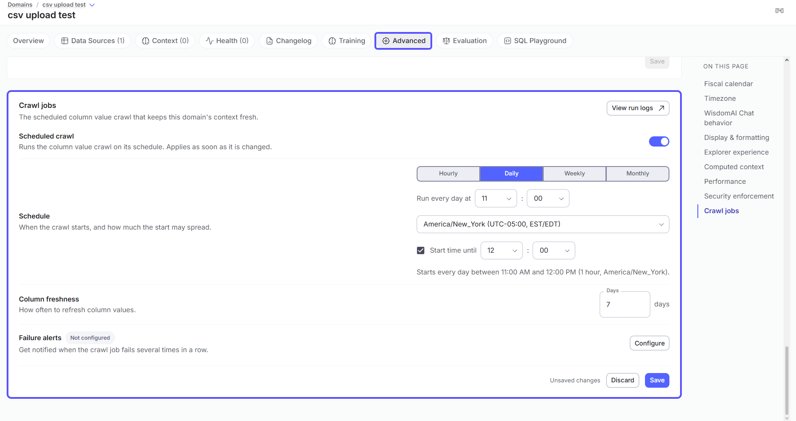

The Advanced tab provides granular control over various operational and presentation aspects of your domain. You can fine-tune display preferences, set fiscal year configurations, and customize the AI's behavior.

This section allows you to configure these settings:

- **Starter Questions:** A list of predefined questions to guide new users.
- **Fiscal Year Configuration:** Settings to define your fiscal year start month and end calendar year.
- **Jobs**: Manage job schedules and view run logs for domain jobs.
- **Column Crawl Schedule:** Configure when the domain crawl should run. You can also disable crawl from here.
- **Display Preferences:** Toggles for compact number display and automatic data panel opening.
- **Row Level Security Config:** Enable or disable this configuration for Admin users.
- **Chat Customization:** A text area for providing system instructions to the AI, for example, "_Always reply in English_".
- **Performance:** Settings that affect how much data queries scan, such as limiting partitioned tables to recent partitions.

<Frame>
  
</Frame>

### **Limit partitioned tables to recent partitions**

Under **Performance**, use this setting to reduce the amount of data scanned when querying partitioned tables. When enabled, WisdomAI restricts queries on partitioned tables to recent partitions.

This setting is enabled by default. Turn it off if your domain needs to query older data.

Required partition filters, such as those enforced by BigQuery, are still applied.