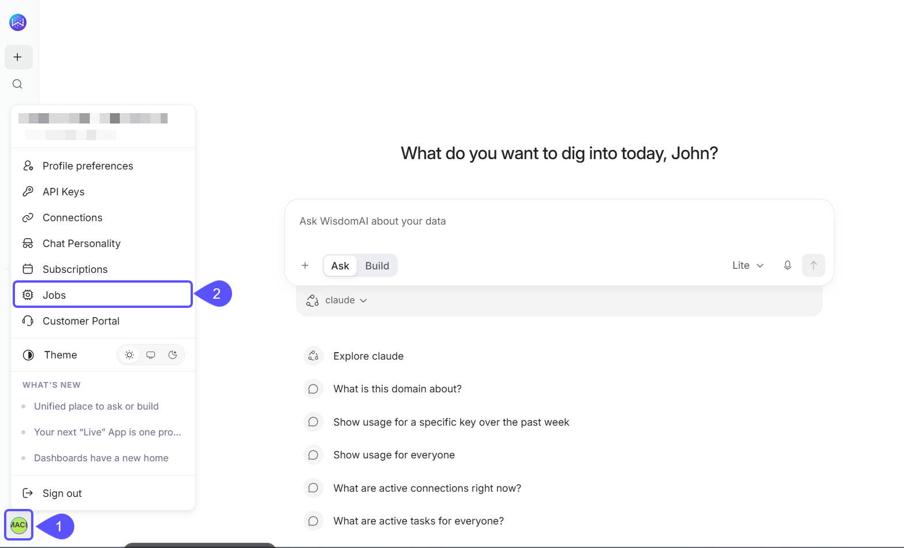

WisdomAI runs background jobs to keep your workspace up to date. They sync connection metadata, crawl column values for domains, refresh dashboards, check domain health, and generate suggestions. The Jobs page lists every scheduled job in your account. Use it to see when jobs run, change schedules for many jobs at once, pause and resume jobs, and review past runs.

<Note>
The Jobs page is available to Site Administrators. Other users don't see it in the menu.
</Note>

## Open the Jobs page

To open, you have to:

1. Click your name at the bottom of the left sidebar to open the user menu.
2. Click **Jobs**.
   
The page has two tabs. **Jobs** lists scheduled jobs and their schedules, and **Job runs** lists individual runs.

## The Jobs tab

Each row is one job. A job belongs to one item in your account, such as a domain, a connection, or a dashboard, and runs on a schedule.

| Column | What it shows |
| ----- | ----- |
| Job ID | The job's unique ID. Hover over it to see the job type. |
| Entity | The item the job runs for. Click the name to open that domain, connection, or dashboard, or hover over it to see the item type. Jobs that run for your whole account show **Account**. |
| Status | **Active** jobs run on their schedule. **Paused** jobs don't run until someone resumes them. |
| Updated at | When the job last changed, for example when it last ran or was paused. |
| Schedule | How often the job runs, for example **Hourly**, **Every 6 hours**, **Daily**, **Weekly**, or **Monthly**. Hover over it to see the exact time and time zone, the start window if one is set, and where the schedule comes from. |

The hover text on a schedule names its source:

| Source | What it means |
| ----- | ----- |
| **Default schedule** | The job runs on WisdomAI's built-in schedule for its type. |
| **Own override** | Someone set a schedule for this job. |
| **Job-type override** | The job follows a schedule set for every job of its type in your account. |
| **Account-wide override** | The job follows a schedule set for your whole account. |

Two other values can appear in the Schedule column. **Off** means a schedule override switched the job off. For example, turning off a dashboard's automatic refresh shows **Off** here while the Status stays **Active**. **Fixed interval** means the job repeats every few minutes or hours instead of running at set times.

### Find jobs

Use the filters above the table:

| Filter | What it does |
| ----- | ----- |
| **Job Types** | Shows one or more job types. |
| **Status** | Shows Active or Paused jobs. |
| **Entity ID** | Finds the jobs of one domain, connection, or dashboard when you type its ID. You can also type part of a job ID. Names don't match. |

Click **Clear filters** to reset them. The table shows 25 jobs per page by default.

### Change several jobs at once

Follow these steps to set schedules, clear overrides, pause, or resume many jobs in one action:

1. Select jobs with the checkboxes. The checkbox in the header selects every job on the current page. To select every job that matches your filters, click **Select all *N* matching** in the banner above the table. One action can change up to 1,000 jobs, so narrow the filters if more match.
2. In the action bar at the bottom of the page, choose an action:
   * **Set schedule** gives the selected jobs their own schedule. See [Set a schedule](#set-a-schedule).
   * **Clear override** removes the selected jobs' own schedule. They go back to the schedule they inherit from their job type, the account, or the default.
   * **Pause** stops the selected jobs from running on their schedule until they're resumed.
   * **Resume** puts the selected jobs back on their schedule.
3. Confirm. A message tells you how many jobs changed. If some couldn't be changed, the message lists each one with the reason.

Jobs that run for your whole account (their Entity shows **Account**) and a few system jobs can't have their own schedule or be paused. If you include them in an action, the message lists them as not supported.

### Set a schedule

**Set schedule** opens a dialog. If all the selected jobs share a schedule, the dialog opens with that schedule filled in. To set a schedule, you must:

1. Choose how often the jobs run:
   * **Hourly**: every hour, or every 2, 3, 4, 6, 8, or 12 hours, at the minute you choose.
   * **Daily**: every day at the time you choose.
   * **Weekly**: on the days you pick, or **Weekdays**, **Weekends**, or **Every day**, at the time you choose.
   * **Monthly**: on one day of the month (1st to 31st) at the time you choose.
2. Choose a time zone.
3. Optional: select **Start within a time range** and set the end of the range in **Start time until**. Each run then starts at a random moment in that range, so jobs on the same schedule don't all hit your warehouse in the same minute. The range starts at 1 hour, or 30 minutes for hourly schedules. An end time earlier than the start time runs into the next day. A line under the controls sums up the result, for example "Starts every day between 9:00 AM and 10:00 AM (1 hour, UTC)."
4. Click **Apply**.

<Note>
A new schedule shows on the Jobs tab right away. WisdomAI applies it to the jobs within about 10 minutes. **Pause** and **Resume** take effect immediately.
</Note>

### How a job's schedule is decided

A job follows the most specific schedule that applies to it, in this order:

1. Its own schedule (**Own override**). You can set it on this page, in a domain's **Crawl jobs** settings, or in a dashboard's **Background refresh** settings.
2. A schedule for every job of its type (**Job-type override**).
3. A schedule for the whole account (**Account-wide override**).
4. WisdomAI's default for the job type (**Default schedule**).

**Clear override** removes only a job's own schedule. WisdomAI manages job-type and account-wide schedules, contact support to change them.

Two other places in the product set the same schedules:

* **Domain → Advanced → Crawl jobs** sets the domain's column value crawl. A schedule saved there shows as **Own override** on the domain's **Crawl Column Values** job, and the **Scheduled crawl** switch does the same thing as **Pause** and **Resume** here.
* A dashboard's **Background refresh** settings set its **Refresh Dashboard** job. **Disable automatic refresh** shows as **Off** here.

## The Job runs tab

**Job runs** lists every job run in your account, newest first, including runs started on demand. Each run is a card with the time the run was created, its status, its job type, the item it ran for, and, once it finishes, how long it took. Expand a card to see the run ID, the steps the run went through, and the error message if it failed. **Copy error message** copies the error.

Filter the list by **Job Types**, by status (**Success**, **Failed**, **Running**, **Queued**, **Canceled**, or **Skipped**), and by date. The date filter starts at **Last 7 days**. You can switch to the last 30 or 90 days or all time, or pick a **From** and **To** date. The list refreshes every 10 seconds.

To see the runs of a single job, open the job's **⋮** menu on the **Jobs** tab and click **View runs**.

### Cancel a run

Runs that are **Running** or **Queued** show **Cancel run**. You can't undo a cancellation. You can cancel a run you started, or any run for an item you can edit.

## Who can do what

Access to the Jobs page, to changing jobs, and to canceling runs depends on your role and your edit access.

| Action | Who can do it |
| ----- | ----- |
| Open the Jobs page and see every job and run | Site Administrators |
| Set a schedule, clear an override, pause, or resume a job | Site Administrators who also have edit access to the job's domain, connection, or dashboard |
| Cancel a run | The person who started the run, or anyone who can edit the item it belongs to |

## Job types

The main job types you'll see:

| Runs for | Job type | What it does | Default schedule |
| ----- | ----- | ----- | ----- |
| Connection | Crawl Metadata | Syncs the connection's databases, tables, and columns, or finds new files for file sources. **Sync now** on the Connections page runs it on demand. | Daily |
| Connection | Query History Enrichment | Reads recent query history from warehouses that support it. | Every 2 hours |
| Domain | Crawl Column Values | Collects the values in the domain's columns. Filters, autocomplete, and value matching in questions use them. | Daily |
| Domain | Domain Health Check | Checks that the domain's tables are still accessible. | Daily |
| Domain | Reviewed Query Staleness Check | Checks reviewed queries, metrics, and evaluation answers for staleness. | Daily |
| Domain | Draft Query Harvest | Turns questions and SQL from chats into draft reviewed queries. | Daily |
| Domain | Table Metadata | Computes table previews. | Weekly |
| Domain | Generate Agent Suggestions, Generate Live App Suggestions | Suggest agents and Live Apps for the domain. | Weekly |
| Domain | Unstructured Index Job, Unstructured File Index Merge Job | Keep the search index for the domain's files up to date. | Daily, and every 5 minutes |
| Dashboard | Refresh Dashboard | Refreshes the dashboard's data in the background. It can't run more often than once an hour. | Daily |
| Account | Maintenance jobs, for example SSO Sync and Garbage Collection | Keep the account running. You can see these jobs and their runs, but WisdomAI manages their schedules. | Varies |

Subscriptions, agents, and domain evaluations are scheduled from their own pages, so they don't appear on the **Jobs** tab. Their runs do appear on the **Job runs** tab.
